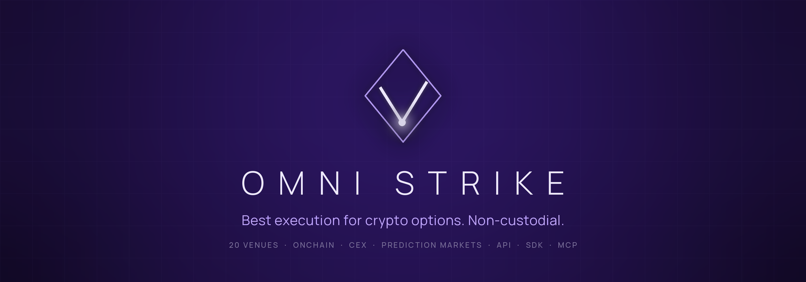
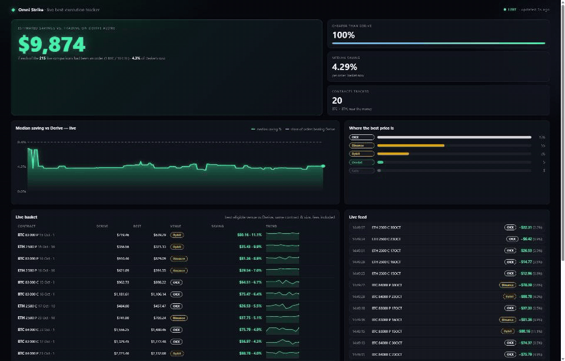
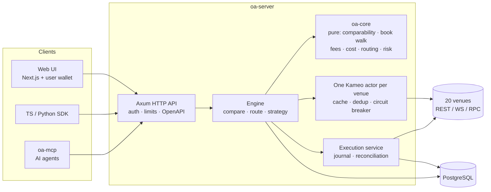
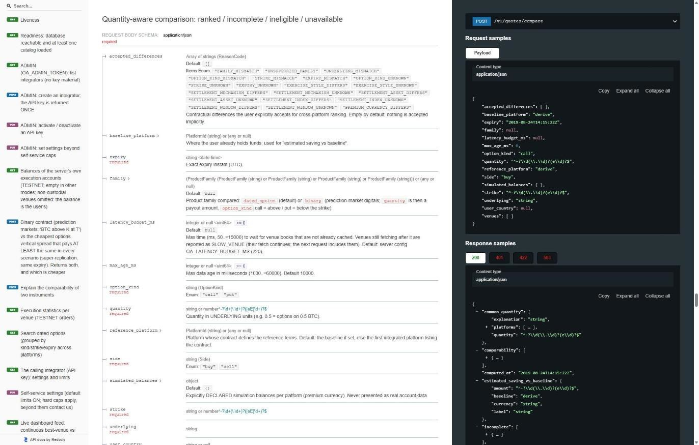
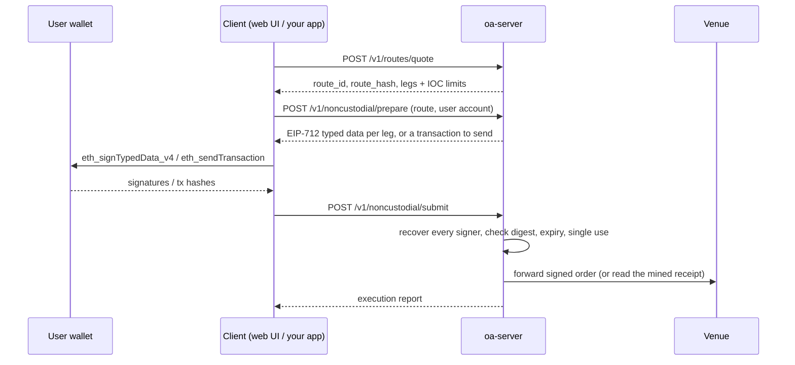

<p align="center">
  
</p>

**English** · [Русский](README.ru.md) · [简体中文](README.zh-CN.md)

**Best execution for crypto options across onchain venues, centralized exchanges and prediction
markets — with the user's wallet signing every order.**

Omni Strike answers one question: *for this option, side and size, where is the cheapest price
that can actually be executed right now — and what exactly is different between the venues?*
It normalises 20 live venues into one contract model, walks their order books with each venue's
real fee formula, refuses to compare contracts that are not economically the same unless you
accept each difference explicitly, and routes the order to one venue or splits it across several.
On onchain venues the end user signs every order in their own wallet: the server never holds a
key and cannot move funds.

[](https://github.com/SKorhacker/omni-strike/actions/workflows/ci.yml)
[](LICENSE)


> **Not financial advice. No warranty.** This software can place real orders on real venues when
> you build and configure it to do so. Read [Security model](#security-model) and
> [Disclaimer](#disclaimer) before running anything outside read-only mode.

## See it live

<p align="center">
  
</p>

The live tracker (`/live` in the web UI) re-prices a basket of near-the-money BTC and ETH
contracts continuously and compares the best eligible venue with Derive alone, fees included.
Recorded on a local read-only server with public market data. Figures are estimates for 1 BTC /
10 ETH orders at that moment; centralized venues require the user's own account.

---

## Contents

- [What it does](#what-it-does)
- [Venues](#venues)
- [How it works](#how-it-works)
- [Quick start](#quick-start)
- [Trading modes](#trading-modes)
- [API](#api)
- [Non-custodial execution](#non-custodial-execution)
- [SDKs and MCP](#sdks-and-mcp)
- [For AI agents](#for-ai-agents)
- [Configuration](#configuration)
- [Security model](#security-model)
- [Testing](#testing)
- [Deployment](#deployment)
- [Project layout](#project-layout)
- [Limitations](#limitations)
- [Contributing](#contributing) · [License](#license) · [Disclaimer](#disclaimer)

## What it does

- **Compare** one contract (underlying, call/put, strike, expiry instant) across every venue that
  lists it: total cost for *your* size (book walk + fees), not the top-of-book price.
- **Comparability verdicts** — `STRICTLY_COMPARABLE`, `ECONOMICALLY_SIMILAR_WITH_DIFFERENCES`,
  `NOT_COMPARABLE`, `INSUFFICIENT_INFORMATION` — with reason codes (settlement index, settlement
  window, premium currency, exercise style…). Venues are only ranked against each other after the
  caller accepts each difference.
- **Unknown costs are never zero.** A venue whose fee or settlement cost is unknown is excluded
  from routing and the reason is returned.
- **Route** a buy order to the single cheapest venue, or split it across 2–3 venues when the
  saving beats the extra fixed fees. Each leg gets an IOC limit price.
- **Multi-leg strategies** (1–6 legs): best venue per leg vs. everything on one venue, with
  max-loss checks.
- **Binaries vs options**: compares a prediction-market binary (Kalshi, Hyperliquid HIP-4,
  Limitless, Myriad) with the cheapest options vertical spread that pays at least as much in every
  scenario.
- **Execute non-custodially**: the server prepares the exact EIP-712 payload or transaction, the
  user's wallet signs or sends it, the server verifies the signer and forwards it.
- **Live prices** over Server-Sent Events, **webhooks** with HMAC signatures, **per-integrator
  API keys and limits**, **geo restrictions** compiled from each venue's terms.
- One engine behind the **HTTP API** (OpenAPI 3), the **web UI**, the **TypeScript and Python
  SDKs** and an **MCP server** for AI agents.

## Venues

Quotes come from 20 integrated connectors (public market data, no keys needed). 8 more platforms
are inventoried with the reason they are not integrated (`GET /v1/platforms`).

| Venue | Type | Quotes | Execution |
|---|---|---|---|
| Derive (v3) | Onchain order book | ✅ REST + WebSocket | Non-custodial (EIP-712) · web wallet · testnet |
| Aevo | Onchain order book | ✅ | Non-custodial (EIP-712 + integrator HMAC) · testnet |
| Paradex | Starknet order book | ✅ | Non-custodial (SNIP-12) |
| Thetanuts V4 | Onchain RFQ book (Base) | ✅ | Non-custodial transaction · web wallet |
| CallPut | Onchain pool (Base) | ✅ | Non-custodial transaction · web wallet |
| Hypercall | Hyperliquid options | ✅ | Non-custodial (EIP-712) |
| Hegic | Onchain (Arbitrum) | ✅ ask only | — |
| Rysk | Onchain RFQ | ✅ indicative, shown, never routed | — |
| Deribit | CEX (USDC linear) | ✅ REST + WebSocket | Testnet (API key) |
| OKX | CEX | ✅ REST + WebSocket | Demo trading (API key) |
| Bybit | CEX (USDT) | ✅ REST + WebSocket | Testnet (API key) |
| Binance | CEX (USDT) | ✅ REST + WebSocket | — |
| Bullish, Coincall, Gate, Delta Exchange | CEX | ✅ | — |
| Kalshi | Binary (regulated) | ✅ | — |
| Hyperliquid HIP-4 | Binary (onchain) | ✅ | Non-custodial (EIP-712) |
| Limitless | Binary (onchain) | ✅ | Non-custodial (EIP-712 + integrator HMAC) |
| Myriad | Binary (onchain) | ✅ | — |

USDT-quoted venues are converted to USDC at a live rate before ranking. Default underlyings: BTC,
ETH, SOL, XRP, HYPE (`OA_UNDERLYINGS`).

## How it works



1. **Connectors** (`crates/adapters`) turn each venue's native catalog and book into one canonical
   model, keeping native ids and every contract term.
2. **Venue actors** (`crates/app/src/venue.rs`) own a bounded cache per venue, deduplicate
   in-flight fetches, keep WebSocket books warm and open a circuit breaker on repeated failures or
   HTTP 429. A failed fetch replaces the cached value: stale data is never served silently.
3. **The core** (`crates/core`, no I/O) decides comparability, walks the book for the requested
   size, applies the venue's fee formula, ranks, builds routes and checks risk limits.
4. **Execution** journals every state transition in Postgres *before* the next step; an unknown
   outcome is reconciled from the venue, never resubmitted.

**Every mechanism as a diagram** — comparability, cost, routing, risk checks, modes, the wallet
flow, the order lifecycle, the circuit breaker, deployment: [docs/diagrams.md](docs/diagrams.md).
Details: [docs/architecture.md](docs/architecture.md), [docs/routing.md](docs/routing.md),
[docs/comparability.md](docs/comparability.md).

## Quick start

Requirements: Rust (the pinned 1.92 toolchain installs itself from `rust-toolchain.toml`),
PostgreSQL 16, Node.js 24 + pnpm 10 for the UI. On Windows, build with the MSVC toolchain from
PowerShell or CMD.

```sh
git clone https://github.com/SKorhacker/omni-strike.git && cd omni-strike

# 1. A database (Docker shown; any PostgreSQL 16 works)
export OA_PG_PASSWORD=$(openssl rand -hex 16)
docker compose up -d                      # Postgres on 127.0.0.1:5433

# 2. Configuration
cp .env.example .env
sed -i "s/CHANGE_ME/$OA_PG_PASSWORD/" .env   # DATABASE_URL

# 3. API (read-only mode, loopback only; migrations run at startup)
cargo run --release -p oa-app --bin oa-server        # http://127.0.0.1:8080

# 4. Web UI
cd web && pnpm install --frozen-lockfile && pnpm dev # http://localhost:3000
```

First request:

```sh
curl -s -X POST http://127.0.0.1:8080/v1/quotes/compare \
  -H 'content-type: application/json' \
  -d '{"underlying":"BTC","option_kind":"call","strike":"120000","expiry":"2026-12-25T08:00:00Z",
       "side":"buy","quantity":"1",
       "accepted_differences":["SETTLEMENT_INDEX_DIFFERS","SETTLEMENT_WINDOW_UNKNOWN",
                               "SETTLEMENT_WINDOW_DIFFERS","SETTLEMENT_ASSET_DIFFERS",
                               "PREMIUM_CURRENCY_DIFFERS"]}'
```

Pick a strike and expiry that are listed today (`GET /v1/instruments?underlying=BTC`). Decimals
are strings everywhere. Interactive docs: `GET /docs`; spec: `GET /openapi.json`.

## Trading modes

Execution capability is decided **at compile time and at startup**, never by a request.

| Mode | Build | What it can do |
|---|---|---|
| `READ_ONLY` (default) | default | Quotes, comparisons, routes. Order endpoints answer `403 EXECUTION_DISABLED`. |
| `SIMULATION` | default | + simulated fills against the recorded book, persisted and replayable. |
| `TESTNET` | `--features testnet` | Real orders on venue **test networks** with test keys held by the server. Own env file and database (name must contain `testnet`). |
| `MAINNET_NONCUSTODIAL` | `--features mainnet-nc` | Real mainnet orders **signed by the end user**. The server holds no key. Own env file and database (name must contain `mainnet_nc`). Kill switch on by default. |
| `LIVE` (custodial) | — | Does not exist. `--features live` is a deliberate compile error. |

`testnet` and `mainnet-nc` cannot be combined. See [docs/testnet.md](docs/testnet.md) and
[docs/mainnet-noncustodial.md](docs/mainnet-noncustodial.md).

## API

Interactive reference served by the server at `GET /docs` (generated from the Rust types):

<p align="center">
  
</p>

| Endpoint | Purpose |
|---|---|
| `GET /v1/platforms` | Every platform, its integration level, capabilities and what is missing |
| `GET /v1/instruments` | Listed contracts per underlying / venue |
| `POST /v1/quotes/compare` | Rank venues for one contract and size |
| `POST /v1/comparability/explain` | Why two contracts are (not) comparable |
| `POST /v1/routes/preview` · `POST /v1/orders/simulate` | Best destination; simulated fill (replayable: `GET/POST /v1/simulations/{id}[/replay]`) |
| `POST /v1/routes/quote` | Executable route: venues, quantities, IOC limits, single-use `route_id` + `route_hash` (30 s) |
| `POST /v1/strategies/quote` · `POST /v1/strategies/route` | Multi-leg strategies |
| `POST /v1/binaries/compare` | Binary vs super-replicating options spread |
| `GET /v1/stream/quotes` | Live best price (SSE) |
| `POST /v1/noncustodial/prepare` · `POST /v1/noncustodial/submit` | Non-custodial execution |
| `POST /v1/noncustodial/orders` | The caller's own orders (wallet-signed) |
| `POST /v1/noncustodial/derive/subaccounts` · `…/derive/account` | The caller's Derive subaccounts, balances and positions (wallet-signed, read-only) |
| `POST /v1/routes/execute-testnet` · `GET /v1/orders[/{id}]` · `GET /v1/exec-stats` | Testnet execution and the order journal |
| `GET /v1/integrator/me` · `PUT /v1/integrator/settings` | Integrator self-service |
| `/v1/admin/integrators…` | Operator endpoints (admin token) |
| `GET /health/live` · `GET /health/ready` · `GET /v1/metrics` | Health and metrics |

Errors share one envelope: `{"error": {"code": "…", "message": "…"}}`. The complete guide, with
request bodies and the webhook signature scheme, is [docs/integrators.md](docs/integrators.md)
(also served at `GET /docs`).

## Non-custodial execution



- The server builds the payload; the **user's wallet** signs it. The server recovers the signer
  from each signature and refuses anything that does not match the account declared at prepare
  time, before anything reaches a venue.
- The EIP-712 domain comes from the attached venue (chain id), never a default: a testnet
  signature cannot be replayed on mainnet or the reverse.
- Prepared executions are stored in Postgres and taken exactly once, across all instances.
- Orders are IOC limit orders: they fill immediately or are cancelled by the venue. Nothing rests.
- Transaction venues (Thetanuts, CallPut): the wallet sends the transaction itself; the server
  only reads the public receipt and checks it is exactly the prepared call. USDC approvals are
  exact amounts, and only requested when the current allowance is lower.
- Caps (per order and over a rolling window, read from the order journal) and a kill switch
  apply server-wide. Selling is disabled in this mode.

The web UI implements the browser flow for Derive, Thetanuts and CallPut with any EIP-6963 wallet
(MetaMask, Rabby, Coinbase Wallet…), without a wallet library. Other venues need a client-side
secret (Aevo, Limitless HMAC) or a Starknet account (Paradex) and are used through the SDKs.

## SDKs and MCP

- **TypeScript** — [`sdk/typescript`](sdk/typescript/README.md), zero runtime dependencies.
- **Python** — [`sdk/python`](sdk/python/README.md), stdlib only, decimals as `Decimal`.
- **MCP** — `oa-mcp` is a stdio MCP server exposing quotes, routes, simulations and order status
  to AI agents; it forwards to the HTTP API, so it uses the same validation and limits. No
  mainnet execution tool exists; testnet execution through MCP is off unless explicitly enabled.
  See [docs/mcp.md](docs/mcp.md).

```ts
import { OmniStrike } from "@omni-strike/sdk";
const os = new OmniStrike({ baseUrl: "http://127.0.0.1:8080", apiKey: process.env.OMNI_KEY });
const q = await os.compareQuotes({ underlying: "ETH", option_kind: "call", strike: "4000",
  expiry: "2026-12-25T08:00:00Z", side: "buy", quantity: "10", accepted_differences: [] });
console.log(q.ranked[0]);
```

## For AI agents

The repository is set up so an agent can use the product and work on the code without guessing.

| You want to… | Use |
|---|---|
| Let an agent **quote and route options** | The MCP server (`oa-mcp`, [docs/mcp.md](docs/mcp.md)) or the skill [`.claude/skills/omni-strike-api`](.claude/skills/omni-strike-api/SKILL.md) |
| Let a coding agent **change the code safely** | [AGENTS.md](AGENTS.md): layout, commands, rules, where things live (read by Claude Code, Codex, Cursor, Copilot and others) |
| Give an agent **step-by-step procedures** | Skills in [`.claude/skills/`](.claude/skills): `add-venue`, `verify`, `omni-strike-api` |
| Feed the docs to a model | [`llms.txt`](llms.txt): a short index of the documentation, in the llmstxt.org format |

## Configuration

The server reads `.env` (or the file named by `OA_ENV_FILE`). Templates: [`.env.example`](.env.example),
[`.env.testnet.example`](.env.testnet.example), [`.env.mainnet-nc.example`](.env.mainnet-nc.example),
[`deploy/.env.example`](deploy/.env.example).

| Variable | Default | Meaning |
|---|---|---|
| `DATABASE_URL` | — (required) | PostgreSQL URL. Never logged. |
| `OA_TRADING_MODE` | `READ_ONLY` | `READ_ONLY`, `SIMULATION`, `TESTNET`*, `MAINNET_NONCUSTODIAL`* (*matching build only) |
| `OA_BIND` | `127.0.0.1:8080` | A non-loopback address is refused unless `OA_API_TOKEN` is set |
| `OA_API_TOKEN` | — | Bearer token required on every API call when set |
| `OA_REQUIRE_API_KEY` | `false` | Require a per-integrator key on API calls |
| `OA_PUBLIC_RPS` | 10 | Per-client-IP rate limit for callers without an integrator key (0 = off; loopback exempt) |
| `OA_ADMIN_TOKEN` | — | Enables `/v1/admin/*` (≥ 24 characters, otherwise ignored) |
| `OA_KILL_SWITCH` | on | Every order is refused unless set to exactly `false` |
| `OA_MAINNET_MAX_ORDER_USD` / `OA_MAINNET_MAX_SESSION_USD` | 100 / 500 | Server-wide caps (hard ceilings 25 000 / 100 000) |
| `OA_SESSION_WINDOW_HOURS` | 24 | Rolling window of the session cap (1–720) |
| `OA_<VENUE>_NONCUSTODIAL` | `false` | Attach a user-signed venue (`DERIVE`, `AEVO`, `PARADEX`, `THETANUTS`, `CALLPUT`, `HYPERCALL`, `HYPERLIQUID`, `LIMITLESS`) |
| `OA_REQUIRE_USER_COUNTRY` | `false` | Make `user_country` mandatory for executable routes |
| `OA_GEO_POLICY_FILE` | embedded | Override [`config/geo-policy.json`](config/geo-policy.json) |
| `OA_UNDERLYINGS` | `BTC,ETH,SOL,XRP,HYPE` | Underlyings to load |
| `OA_LATENCY_BUDGET_MS` | 220 | Max wait for uncached venue books per comparison |
| `OA_REQUEST_TIMEOUT_MS`, `OA_MAX_INFLIGHT`, `OA_MAX_CONCURRENT_COMPARES`, `OA_DB_MAX_CONNECTIONS` | see code | Load limits |
| `OA_LIVE`, `OA_HOT_REFRESH`, `OA_BULK_TOPS` | on | Background price tracking and refresh (`off` to disable) |
| `OA_SIMULATION_RETENTION_DAYS` | 30 | Simulations older than this are purged hourly (expired route quotes and prepared executions after 1 day; the order journal is kept) |
| `OA_WEBHOOK_ALLOW_LOCAL` | `false` | Development only: accept `http://localhost` webhook URLs |
| `OA_LOG_FORMAT`, `RUST_LOG` | text, `info` | `json` for one JSON object per line |

Testnet keys (`OA_DERIVE_TESTNET_*`, `OA_AEVO_TESTNET_*`, `OA_BYBIT_TESTNET_*`,
`OA_DERIBIT_TESTNET_*`, `OA_OKX_DEMO_*`) are read only by a `testnet` build.

## Security model

- **No custody.** No build can hold a user's mainnet key; the mainnet attach function has no
  access to any key loader. Custodial live trading does not compile.
- **Defense in depth on execution:** compile-time feature gates, startup checks (mode, database
  name, bind address, token strength, leftover placeholders), kill switch on by default,
  server-wide caps from the journal re-checked at submission (unsigned preparations never count),
  single-use hash-bound routes (30 s), signatures valid 5 minutes and verified before a prepared
  execution is consumed, single-use submissions, IOC only, buy-only on mainnet.
- **The web UI checks what it signs:** it refuses typed data for another contract or wallet,
  transactions to unknown contracts, unexpected ETH value and USDC approvals above the signed
  worst cost — even if the server were compromised.
- **Short-lived user credentials are used once and never journaled** (Derive REST auth
  signature, Paradex JWT, Aevo HMAC). Wallet-signed read endpoints verify the signature locally
  before forwarding anything.
- **Private journal:** on mainnet the order journal is not listable; each user reads their own
  orders with a wallet signature.
- **Network surface:** loopback bind by default; non-loopback requires a token; body-size,
  concurrency, per-integrator and per-IP rate limits; webhooks only to public hosts (no redirects,
  DNS pinned); containers run non-root with all capabilities dropped; Caddy blocks `/v1/admin`
  and only proxies the endpoints the UI needs.
- **Untrusted data:** venue-supplied text is treated as data (MCP results are prefixed with a
  notice); decimals never go through floats.

Report vulnerabilities privately: see [SECURITY.md](SECURITY.md).

## Testing

```sh
cargo test --workspace                       # offline: no network, no database, cannot trade
cargo test -p oa-app --features mainnet-nc   # mainnet non-custodial build
cargo clippy --workspace --all-targets -- -D warnings   # also with --features testnet / mainnet-nc
cd web && pnpm lint && pnpm exec tsc --noEmit && pnpm build
cd sdk/typescript && npx -p typescript tsc -p . && npm test ; cd ../python && python -m pytest -q
```

- Venue parsers are tested against **recorded real responses** (`fixtures/recorded-*`).
- Signing is tested against **reference vectors** produced by the venues' own libraries
  (`fixtures/*_vector*.json`, generators in `scripts/gen_*_vectors.py`) and cross-checked with
  `eth_abi` / `eth_account` (`scripts/check_*.py`).
- The full prepare → sign → submit flow runs against local fake venues in `crates/app/src/e2e_tests.rs`.
- Opt-in: `--features live-tests` hits real public endpoints (read-only);
  `OA_TEST_DATABASE_URL=… cargo test -p oa-app pg_tests` runs the store against a real Postgres;
  `scripts/e2e_live.py` drives a running stack, including the MCP binary.
- `cargo run --release -p oa-app --bin oa-bench` replays recorded books to measure the engine
  without network; `oa-load` load-tests a running server.

## Deployment

Docker images (`Dockerfile`, `deploy/web.Dockerfile`), a single-node Compose stack with Caddy
(automatic HTTPS), Prometheus, and a separate stack for mainnet non-custodial with its own
database: [docs/deployment.md](docs/deployment.md). `deploy/vps-bootstrap.sh` hardens a fresh
Ubuntu/Debian host (firewall, fail2ban, key-only SSH, unattended upgrades).

## Project layout

```
crates/
  core/       pure domain logic: comparability, book walk, fees, cost, routing, risk (no I/O)
  adapters/   venue connectors (market data) and execution venues (*_exec custodial testnet,
              *_user non-custodial), shared HTTP client, platform registry
  app/        engine, Kameo venue actors, execution service, Axum API, OpenAPI, MCP, Postgres store
    migrations/   forward-only, non-destructive SQL, embedded and applied at startup
    src/bin/      oa-server, oa-mcp, oa-bench, oa-load
web/          Next.js UI (compare, route, wallet execution, my orders)
sdk/          TypeScript and Python clients, OpenAPI drift check
config/       geo policy compiled from venue terms
fixtures/     recorded venue responses and signing vectors for offline tests
scripts/      signing-vector generators, ABI cross-checks, testnet and first-order helpers
deploy/       Compose stacks, Caddy, Prometheus, VPS bootstrap
docs/         diagrams, architecture, routing, comparability, API guide, deployment, modes, MCP
.claude/skills/  step-by-step procedures for AI agents (use the API, add a venue, verify)
```

## Limitations

- Quotes are computed from public books: a quote is an estimate until the venue fills the order.
- Legs of a split are not atomic across venues; each is IOC and a partial split is reported, not
  re-routed.
- Some venues publish incomplete fee schedules; they are excluded from routing until the missing
  cost is known.
- Non-custodial orders still reach venues from the server's IP: venue geo rules apply
  (`config/geo-policy.json`), and operators remain responsible for the jurisdictions they serve.
  `user_country` is declared by the client: the geo filter is only as reliable as the integrator
  that sets it.
- The per-session cap is server-wide, not per user.

## Contributing

Issues and pull requests are welcome — see [CONTRIBUTING.md](CONTRIBUTING.md). Adding a venue:
implement `Connector` in `crates/adapters`, add recorded fixtures and a parser test, register it
in `crates/app/src/bin/server.rs` and `crates/adapters/src/registry.rs`.

## License

[MIT](LICENSE).

## Disclaimer

This project is provided as is, without warranty of any kind. It is not investment advice and not
an offer of any financial service. Options and prediction markets can lose 100% of the premium.
Anyone running it is responsible for complying with the laws of their jurisdiction and with each
venue's terms of service, and for reviewing the code before trusting it with funds.
