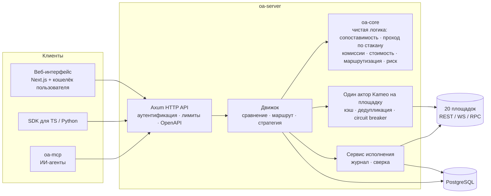
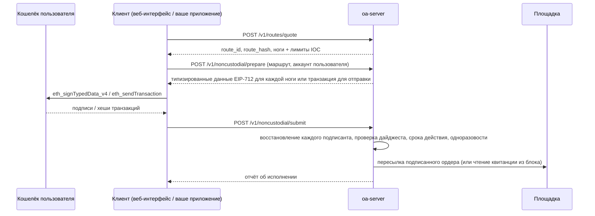

<p align="center">
  
</p>

[English](README.md) · **Русский** · [简体中文](README.zh-CN.md)

**Лучшее исполнение для криптоопционов на ончейн-площадках, централизованных биржах и рынках
предсказаний — каждый ордер подписывается кошельком пользователя.**

Omni Strike отвечает на один вопрос: *для этого опциона, направления и объёма — где самая низкая цена,
по которой можно реально исполниться прямо сейчас, и чем именно отличаются площадки?*
Он приводит 20 действующих площадок к единой модели контракта, проходит по их стаканам с реальной
формулой комиссии каждой площадки, отказывается сравнивать контракты, которые экономически не
идентичны, пока вы явно не примете каждое отличие, и направляет ордер на одну площадку или
разбивает его между несколькими.
На ончейн-площадках конечный пользователь подписывает каждый ордер в своём кошельке: сервер никогда
не хранит ключ и не может перемещать средства.

[](https://github.com/SKorhacker/omni-strike/actions/workflows/ci.yml)
[](LICENSE)


> **Не является финансовой рекомендацией. Без каких-либо гарантий.** Это ПО может выставлять реальные
> ордера на реальных площадках, если вы соберёте и настроите его для этого. Прочитайте разделы
> [Модель безопасности](#модель-безопасности) и [Отказ от ответственности](#отказ-от-ответственности),
> прежде чем запускать что-либо вне режима только для чтения.

## Вживую

<p align="center">
  
</p>

Живой трекер (`/live` в веб-интерфейсе) непрерывно переоценивает корзину BTC- и ETH-контрактов
около денег и сравнивает лучшую допустимую площадку с одной лишь Derive, с учётом комиссий.
Записано на локальном сервере в режиме только чтения с публичными рыночными данными. Цифры — оценки
для ордеров 1 BTC / 10 ETH на тот момент; централизованные площадки требуют собственного аккаунта пользователя.

---

## Содержание

- [Что он делает](#что-он-делает)
- [Площадки](#площадки)
- [Как это работает](#как-это-работает)
- [Быстрый старт](#быстрый-старт)
- [Режимы торговли](#режимы-торговли)
- [API](#api)
- [Некастодиальное исполнение](#некастодиальное-исполнение)
- [SDK и MCP](#sdk-и-mcp)
- [Для ИИ-агентов](#для-ии-агентов)
- [Конфигурация](#конфигурация)
- [Модель безопасности](#модель-безопасности)
- [Тестирование](#тестирование)
- [Развёртывание](#развёртывание)
- [Структура проекта](#структура-проекта)
- [Ограничения](#ограничения)
- [Участие в разработке](#участие-в-разработке) · [Лицензия](#лицензия) · [Отказ от ответственности](#отказ-от-ответственности)

## Что он делает

- **Сравнивает** один контракт (базовый актив, колл/пут, страйк, момент экспирации) на всех
  площадках, где он торгуется: полная стоимость для *вашего* объёма (проход по стакану + комиссии),
  а не лучшая цена в стакане.
- **Вердикты о сопоставимости** — `STRICTLY_COMPARABLE`, `ECONOMICALLY_SIMILAR_WITH_DIFFERENCES`,
  `NOT_COMPARABLE`, `INSUFFICIENT_INFORMATION` — с кодами причин (индекс расчёта, окно расчёта,
  валюта премии, стиль исполнения…). Площадки ранжируются друг относительно друга только после того,
  как вызывающая сторона примет каждое отличие.
- **Неизвестные издержки никогда не считаются нулевыми.** Площадка, у которой неизвестна комиссия
  или стоимость расчёта, исключается из маршрутизации, и причина возвращается в ответе.
- **Маршрутизирует** ордер на покупку на одну самую дешёвую площадку или разбивает его между 2–3
  площадками, когда экономия превышает дополнительные фиксированные комиссии. Каждая нога получает
  лимитную цену IOC.
- **Многоногие стратегии** (1–6 ног): лучшая площадка для каждой ноги против всех ног на одной
  площадке, с проверкой максимального убытка.
- **Бинарные контракты против опционов**: сравнивает бинарный контракт рынка предсказаний (Kalshi,
  Hyperliquid HIP-4, Limitless, Myriad) с самым дешёвым опционным вертикальным спредом, который
  выплачивает не меньше в любом сценарии.
- **Некастодиальное исполнение**: сервер готовит точный EIP-712 payload или транзакцию, кошелёк
  пользователя подписывает или отправляет их, сервер проверяет подписанта и пересылает ордер.
- **Цены в реальном времени** через Server-Sent Events, **вебхуки** с подписями HMAC, **API-ключи
  и лимиты для каждого интегратора**, **географические ограничения**, составленные по условиям
  каждой площадки.
- Один движок за **HTTP API** (OpenAPI 3), **веб-интерфейсом**, **SDK для TypeScript и Python**
  и **MCP-сервером** для ИИ-агентов.

## Площадки

Котировки поступают из 20 интегрированных коннекторов (публичные рыночные данные, ключи не нужны).
Ещё 8 платформ занесены в реестр с указанием причины, по которой они не интегрированы
(`GET /v1/platforms`).

| Площадка | Тип | Котировки | Исполнение |
|---|---|---|---|
| Derive (v3) | Ончейн-стакан | ✅ REST + WebSocket | Некастодиальное (EIP-712) · веб-кошелёк · testnet |
| Aevo | Ончейн-стакан | ✅ | Некастодиальное (EIP-712 + HMAC интегратора) · testnet |
| Paradex | Стакан на Starknet | ✅ | Некастодиальное (SNIP-12) |
| Thetanuts V4 | Ончейн-книга RFQ (Base) | ✅ | Некастодиальная транзакция · веб-кошелёк |
| CallPut | Ончейн-пул (Base) | ✅ | Некастодиальная транзакция · веб-кошелёк |
| Hypercall | Опционы Hyperliquid | ✅ | Некастодиальное (EIP-712) |
| Hegic | Ончейн (Arbitrum) | ✅ только ask | — |
| Rysk | Ончейн RFQ | ✅ индикативные, отображаются, никогда не маршрутизируются | — |
| Deribit | CEX (линейные в USDC) | ✅ REST + WebSocket | Testnet (API-ключ) |
| OKX | CEX | ✅ REST + WebSocket | Демо-торговля (API-ключ) |
| Bybit | CEX (USDT) | ✅ REST + WebSocket | Testnet (API-ключ) |
| Binance | CEX (USDT) | ✅ REST + WebSocket | — |
| Bullish, Coincall, Gate, Delta Exchange | CEX | ✅ | — |
| Kalshi | Бинарные (регулируемая) | ✅ | — |
| Hyperliquid HIP-4 | Бинарные (ончейн) | ✅ | Некастодиальное (EIP-712) |
| Limitless | Бинарные (ончейн) | ✅ | Некастодиальное (EIP-712 + HMAC интегратора) |
| Myriad | Бинарные (ончейн) | ✅ | — |

Котировки площадок в USDT перед ранжированием пересчитываются в USDC по текущему курсу. Базовые
активы по умолчанию: BTC, ETH, SOL, XRP, HYPE (`OA_UNDERLYINGS`).

## Как это работает



1. **Коннекторы** (`crates/adapters`) переводят нативный каталог и стакан каждой площадки в одну
   каноническую модель, сохраняя нативные идентификаторы и все условия контракта.
2. **Акторы площадок** (`crates/app/src/venue.rs`) владеют ограниченным кэшем для каждой площадки,
   дедуплицируют выполняющиеся запросы, поддерживают стаканы по WebSocket в актуальном состоянии и
   размыкают circuit breaker при повторяющихся сбоях или HTTP 429. Неудачный запрос заменяет
   закэшированное значение: устаревшие данные никогда не отдаются молча.
3. **Ядро** (`crates/core`, без I/O) определяет сопоставимость, проходит по стакану на запрошенный
   объём, применяет формулу комиссии площадки, ранжирует, строит маршруты и проверяет лимиты риска.
4. **Исполнение** записывает каждый переход состояния в журнал в Postgres *до* следующего шага;
   неизвестный исход сверяется с площадкой и никогда не отправляется повторно.

**Каждый механизм в виде диаграммы** — сопоставимость, стоимость, маршрутизация, проверки рисков,
режимы, поток работы с кошельком, жизненный цикл ордера, circuit breaker, развёртывание:
[docs/diagrams.ru.md](docs/diagrams.ru.md).
Подробности: [docs/architecture.md](docs/architecture.md), [docs/routing.md](docs/routing.md),
[docs/comparability.md](docs/comparability.md).

## Быстрый старт

Требования: Rust (закреплённый тулчейн 1.92 устанавливается сам из `rust-toolchain.toml`),
PostgreSQL 16, Node.js 24 + pnpm 10 для интерфейса. В Windows собирайте с тулчейном MSVC из
PowerShell или CMD.

```sh
git clone https://github.com/SKorhacker/omni-strike.git && cd omni-strike

# 1. A database (Docker shown; any PostgreSQL 16 works)
export OA_PG_PASSWORD=$(openssl rand -hex 16)
docker compose up -d                      # Postgres on 127.0.0.1:5433

# 2. Configuration
cp .env.example .env
sed -i "s/CHANGE_ME/$OA_PG_PASSWORD/" .env   # DATABASE_URL

# 3. API (read-only mode, loopback only; migrations run at startup)
cargo run --release -p oa-app --bin oa-server        # http://127.0.0.1:8080

# 4. Web UI
cd web && pnpm install --frozen-lockfile && pnpm dev # http://localhost:3000
```

Первый запрос:

```sh
curl -s -X POST http://127.0.0.1:8080/v1/quotes/compare \
  -H 'content-type: application/json' \
  -d '{"underlying":"BTC","option_kind":"call","strike":"120000","expiry":"2026-12-25T08:00:00Z",
       "side":"buy","quantity":"1",
       "accepted_differences":["SETTLEMENT_INDEX_DIFFERS","SETTLEMENT_WINDOW_UNKNOWN",
                               "SETTLEMENT_WINDOW_DIFFERS","SETTLEMENT_ASSET_DIFFERS",
                               "PREMIUM_CURRENCY_DIFFERS"]}'
```

Выберите страйк и экспирацию, которые торгуются сегодня (`GET /v1/instruments?underlying=BTC`).
Десятичные числа везде передаются строками. Интерактивная документация: `GET /docs`; спецификация:
`GET /openapi.json`.

## Режимы торговли

Возможность исполнения определяется **при компиляции и при запуске**, но никогда не запросом.

| Режим | Сборка | Что он может делать |
|---|---|---|
| `READ_ONLY` (по умолчанию) | по умолчанию | Котировки, сравнения, маршруты. Эндпоинты ордеров отвечают `403 EXECUTION_DISABLED`. |
| `SIMULATION` | по умолчанию | + симулированные исполнения по записанному стакану, сохраняемые и воспроизводимые. |
| `TESTNET` | `--features testnet` | Реальные ордера в **тестовых сетях** площадок с тестовыми ключами, хранящимися на сервере. Собственный env-файл и база данных (имя должно содержать `testnet`). |
| `MAINNET_NONCUSTODIAL` | `--features mainnet-nc` | Реальные ордера в mainnet, **подписанные конечным пользователем**. Сервер не хранит ключей. Собственный env-файл и база данных (имя должно содержать `mainnet_nc`). Kill switch включён по умолчанию. |
| `LIVE` (кастодиальный) | — | Не существует. `--features live` — намеренная ошибка компиляции. |

`testnet` и `mainnet-nc` нельзя совмещать. См. [docs/testnet.md](docs/testnet.md) и
[docs/mainnet-noncustodial.md](docs/mainnet-noncustodial.md).

## API

Интерактивный справочник, который сервер отдаёт по `GET /docs` (генерируется из типов Rust):

<p align="center">
  
</p>

| Эндпоинт | Назначение |
|---|---|
| `GET /v1/platforms` | Все платформы, их уровень интеграции, возможности и чего не хватает |
| `GET /v1/instruments` | Торгуемые контракты по базовому активу / площадке |
| `POST /v1/quotes/compare` | Ранжирование площадок для одного контракта и объёма |
| `POST /v1/comparability/explain` | Почему два контракта (не) сопоставимы |
| `POST /v1/routes/preview` · `POST /v1/orders/simulate` | Лучшее направление; симулированное исполнение (воспроизводимое: `GET/POST /v1/simulations/{id}[/replay]`) |
| `POST /v1/routes/quote` | Исполнимый маршрут: площадки, количества, лимиты IOC, одноразовые `route_id` + `route_hash` (30 с) |
| `POST /v1/strategies/quote` · `POST /v1/strategies/route` | Многоногие стратегии |
| `POST /v1/binaries/compare` | Бинарный контракт против суперреплицирующего опционного спреда |
| `GET /v1/stream/quotes` | Лучшая цена в реальном времени (SSE) |
| `POST /v1/noncustodial/prepare` · `POST /v1/noncustodial/submit` | Некастодиальное исполнение |
| `POST /v1/noncustodial/orders` | Собственные ордера вызывающей стороны (с подписью кошелька) |
| `POST /v1/noncustodial/derive/subaccounts` · `…/derive/account` | Субаккаунты Derive вызывающей стороны, балансы и позиции (с подписью кошелька, только чтение) |
| `POST /v1/routes/execute-testnet` · `GET /v1/orders[/{id}]` · `GET /v1/exec-stats` | Исполнение в testnet и журнал ордеров |
| `GET /v1/integrator/me` · `PUT /v1/integrator/settings` | Самообслуживание интегратора |
| `/v1/admin/integrators…` | Эндпоинты оператора (токен администратора) |
| `GET /health/live` · `GET /health/ready` · `GET /v1/metrics` | Состояние и метрики |

Все ошибки имеют единый формат: `{"error": {"code": "…", "message": "…"}}`. Полное руководство
с телами запросов и схемой подписи вебхуков — [docs/integrators.md](docs/integrators.md)
(также доступно по `GET /docs`).

## Некастодиальное исполнение



- Сервер формирует payload, а **кошелёк пользователя** его подписывает. Сервер восстанавливает
  подписанта из каждой подписи и отклоняет всё, что не совпадает с аккаунтом, заявленным на этапе
  prepare, ещё до того, как что-либо попадёт на площадку.
- Домен EIP-712 берётся из подключённой площадки (chain id), а не из значения по умолчанию: подпись
  из testnet нельзя воспроизвести в mainnet, и наоборот.
- Подготовленные исполнения хранятся в Postgres и используются ровно один раз во всех инстансах.
- Ордера — лимитные IOC: они исполняются немедленно или отменяются площадкой. Ничего не остаётся
  в стакане.
- Площадки с транзакциями (Thetanuts, CallPut): кошелёк сам отправляет транзакцию; сервер лишь читает
  публичную квитанцию и проверяет, что это ровно подготовленный вызов. Одобрения (approve) USDC
  выдаются на точную сумму и запрашиваются, только когда текущий allowance меньше нужного.
- Лимиты (на ордер и за скользящее окно, рассчитываемые по журналу ордеров) и kill switch действуют
  на весь сервер. Продажа в этом режиме отключена.

Веб-интерфейс реализует браузерный поток для Derive, Thetanuts и CallPut с любым кошельком
EIP-6963 (MetaMask, Rabby, Coinbase Wallet…), без библиотеки для кошельков. Другим площадкам нужен
секрет на стороне клиента (Aevo, Limitless HMAC) или аккаунт Starknet (Paradex), и они используются
через SDK.

## SDK и MCP

- **TypeScript** — [`sdk/typescript`](sdk/typescript/README.md), без зависимостей во время выполнения.
- **Python** — [`sdk/python`](sdk/python/README.md), только стандартная библиотека, десятичные числа
  как `Decimal`.
- **MCP** — `oa-mcp` — это MCP-сервер на stdio, предоставляющий ИИ-агентам котировки, маршруты,
  симуляции и статус ордеров; он пересылает запросы в HTTP API, поэтому использует те же проверки
  и лимиты. Инструмента для исполнения в mainnet не существует; исполнение в testnet через MCP
  выключено, если не включено явно. См. [docs/mcp.md](docs/mcp.md).

```ts
import { OmniStrike } from "@omni-strike/sdk";
const os = new OmniStrike({ baseUrl: "http://127.0.0.1:8080", apiKey: process.env.OMNI_KEY });
const q = await os.compareQuotes({ underlying: "ETH", option_kind: "call", strike: "4000",
  expiry: "2026-12-25T08:00:00Z", side: "buy", quantity: "10", accepted_differences: [] });
console.log(q.ranked[0]);
```

## Для ИИ-агентов

Репозиторий устроен так, чтобы агент мог пользоваться продуктом и работать с кодом, ничего не
угадывая.

| Вы хотите… | Используйте |
|---|---|
| Дать агенту **котировать и маршрутизировать опционы** | MCP-сервер (`oa-mcp`, [docs/mcp.md](docs/mcp.md)) или skill [`.claude/skills/omni-strike-api`](.claude/skills/omni-strike-api/SKILL.md) |
| Дать агенту-программисту **безопасно менять код** | [AGENTS.md](AGENTS.md): структура, команды, правила, где что находится (читается Claude Code, Codex, Cursor, Copilot и другими) |
| Дать агенту **пошаговые процедуры** | Skills в [`.claude/skills/`](.claude/skills): `add-venue`, `verify`, `omni-strike-api` |
| Скормить документацию модели | [`llms.txt`](llms.txt): краткий указатель документации в формате llmstxt.org |

## Конфигурация

Сервер читает `.env` (или файл, указанный в `OA_ENV_FILE`). Шаблоны: [`.env.example`](.env.example),
[`.env.testnet.example`](.env.testnet.example), [`.env.mainnet-nc.example`](.env.mainnet-nc.example),
[`deploy/.env.example`](deploy/.env.example).

| Переменная | По умолчанию | Значение |
|---|---|---|
| `DATABASE_URL` | — (обязательна) | URL PostgreSQL. Никогда не пишется в логи. |
| `OA_TRADING_MODE` | `READ_ONLY` | `READ_ONLY`, `SIMULATION`, `TESTNET`*, `MAINNET_NONCUSTODIAL`* (*только в соответствующей сборке) |
| `OA_BIND` | `127.0.0.1:8080` | Адрес, отличный от loopback, отклоняется, если не задан `OA_API_TOKEN` |
| `OA_API_TOKEN` | — | Bearer-токен, обязательный для каждого вызова API, если задан |
| `OA_REQUIRE_API_KEY` | `false` | Требовать ключ интегратора при вызовах API |
| `OA_PUBLIC_RPS` | 10 | Лимит запросов на IP клиента для вызывающих без ключа интегратора (0 = выкл.; loopback не ограничивается) |
| `OA_ADMIN_TOKEN` | — | Включает `/v1/admin/*` (≥ 24 символов, иначе игнорируется) |
| `OA_KILL_SWITCH` | вкл. | Каждый ордер отклоняется, если значение не равно ровно `false` |
| `OA_MAINNET_MAX_ORDER_USD` / `OA_MAINNET_MAX_SESSION_USD` | 100 / 500 | Лимиты на весь сервер (жёсткие потолки 25 000 / 100 000) |
| `OA_SESSION_WINDOW_HOURS` | 24 | Скользящее окно лимита сессии (1–720) |
| `OA_<VENUE>_NONCUSTODIAL` | `false` | Подключить площадку с подписью пользователя (`DERIVE`, `AEVO`, `PARADEX`, `THETANUTS`, `CALLPUT`, `HYPERCALL`, `HYPERLIQUID`, `LIMITLESS`) |
| `OA_REQUIRE_USER_COUNTRY` | `false` | Сделать `user_country` обязательным для исполнимых маршрутов |
| `OA_GEO_POLICY_FILE` | встроенный | Переопределить [`config/geo-policy.json`](config/geo-policy.json) |
| `OA_UNDERLYINGS` | `BTC,ETH,SOL,XRP,HYPE` | Загружаемые базовые активы |
| `OA_LATENCY_BUDGET_MS` | 220 | Максимальное ожидание незакэшированных стаканов площадок на одно сравнение |
| `OA_REQUEST_TIMEOUT_MS`, `OA_MAX_INFLIGHT`, `OA_MAX_CONCURRENT_COMPARES`, `OA_DB_MAX_CONNECTIONS` | см. код | Лимиты нагрузки |
| `OA_LIVE`, `OA_HOT_REFRESH`, `OA_BULK_TOPS` | вкл. | Фоновое отслеживание и обновление цен (`off` — отключить) |
| `OA_SIMULATION_RETENTION_DAYS` | 30 | Симуляции старше этого срока удаляются ежечасно (истёкшие котировки маршрутов и подготовленные исполнения — через 1 день; журнал ордеров сохраняется) |
| `OA_WEBHOOK_ALLOW_LOCAL` | `false` | Только для разработки: принимать URL вебхуков `http://localhost` |
| `OA_LOG_FORMAT`, `RUST_LOG` | text, `info` | `json` — один JSON-объект на строку |

Ключи testnet (`OA_DERIVE_TESTNET_*`, `OA_AEVO_TESTNET_*`, `OA_BYBIT_TESTNET_*`,
`OA_DERIBIT_TESTNET_*`, `OA_OKX_DEMO_*`) читаются только сборкой `testnet`.

## Модель безопасности

- **Никакого кастодиального хранения.** Ни одна сборка не может хранить mainnet-ключ пользователя;
  функция подключения mainnet не имеет доступа ни к одному загрузчику ключей. Кастодиальная живая
  торговля не компилируется.
- **Эшелонированная защита исполнения:** feature-флаги на этапе компиляции, проверки при запуске
  (режим, имя базы данных, адрес привязки, стойкость токена, оставшиеся заглушки), kill switch
  включён по умолчанию, лимиты на весь сервер по журналу, повторно проверяемые при отправке
  (неподписанные подготовки никогда не учитываются), одноразовые маршруты, привязанные к хешу
  (30 с), подписи действительны 5 минут и проверяются до использования подготовленного исполнения,
  одноразовые отправки, только IOC, в mainnet только покупка.
- **Веб-интерфейс проверяет то, что подписывает:** он отклоняет типизированные данные для другого
  контракта или кошелька, транзакции на неизвестные контракты, неожиданную сумму в ETH и одобрения
  USDC сверх подписанной худшей стоимости — даже если сервер скомпрометирован.
- **Краткоживущие учётные данные пользователя используются один раз и никогда не попадают в журнал**
  (подпись аутентификации Derive REST, JWT Paradex, HMAC Aevo). Эндпоинты чтения с подписью кошелька
  проверяют подпись локально, прежде чем что-либо пересылать.
- **Приватный журнал:** в mainnet журнал ордеров нельзя получить списком; каждый пользователь читает
  свои ордера с подписью кошелька.
- **Сетевая поверхность:** по умолчанию привязка к loopback; для адреса, отличного от loopback,
  требуется токен; ограничения размера тела запроса, параллелизма, лимиты запросов на интегратора и
  на IP; вебхуки только на публичные хосты (без редиректов, с закреплением DNS); контейнеры работают
  не от root со сброшенными capabilities; Caddy блокирует `/v1/admin` и проксирует только эндпоинты,
  нужные интерфейсу.
- **Недоверенные данные:** текст, полученный от площадок, обрабатывается как данные (результаты MCP
  предваряются предупреждением); десятичные числа никогда не проходят через числа с плавающей точкой.

Сообщайте об уязвимостях приватно: см. [SECURITY.md](SECURITY.md).

## Тестирование

```sh
cargo test --workspace                       # offline: no network, no database, cannot trade
cargo test -p oa-app --features mainnet-nc   # mainnet non-custodial build
cargo clippy --workspace --all-targets -- -D warnings   # also with --features testnet / mainnet-nc
cd web && pnpm lint && pnpm exec tsc --noEmit && pnpm build
cd sdk/typescript && npx -p typescript tsc -p . && npm test ; cd ../python && python -m pytest -q
```

- Парсеры площадок тестируются на **записанных реальных ответах** (`fixtures/recorded-*`).
- Подписи тестируются на **эталонных векторах**, сгенерированных собственными библиотеками площадок
  (`fixtures/*_vector*.json`, генераторы в `scripts/gen_*_vectors.py`), и перекрёстно проверяются
  с помощью `eth_abi` / `eth_account` (`scripts/check_*.py`).
- Полный поток prepare → sign → submit прогоняется на локальных фейковых площадках в
  `crates/app/src/e2e_tests.rs`.
- По желанию: `--features live-tests` обращается к реальным публичным эндпоинтам (только чтение);
  `OA_TEST_DATABASE_URL=… cargo test -p oa-app pg_tests` запускает хранилище на реальном Postgres;
  `scripts/e2e_live.py` управляет запущенным стеком, включая бинарник MCP.
- `cargo run --release -p oa-app --bin oa-bench` воспроизводит записанные стаканы, чтобы измерить
  движок без сети; `oa-load` проводит нагрузочное тестирование запущенного сервера.

## Развёртывание

Docker-образы (`Dockerfile`, `deploy/web.Dockerfile`), одноузловой стек Compose с Caddy
(автоматический HTTPS), Prometheus и отдельный стек для некастодиального mainnet с собственной
базой данных: [docs/deployment.md](docs/deployment.md). `deploy/vps-bootstrap.sh` укрепляет свежий
хост Ubuntu/Debian (файрвол, fail2ban, SSH только по ключу, автоматические обновления).

## Структура проекта

```
crates/
  core/       pure domain logic: comparability, book walk, fees, cost, routing, risk (no I/O)
  adapters/   venue connectors (market data) and execution venues (*_exec custodial testnet,
              *_user non-custodial), shared HTTP client, platform registry
  app/        engine, Kameo venue actors, execution service, Axum API, OpenAPI, MCP, Postgres store
    migrations/   forward-only, non-destructive SQL, embedded and applied at startup
    src/bin/      oa-server, oa-mcp, oa-bench, oa-load
web/          Next.js UI (compare, route, wallet execution, my orders)
sdk/          TypeScript and Python clients, OpenAPI drift check
config/       geo policy compiled from venue terms
fixtures/     recorded venue responses and signing vectors for offline tests
scripts/      signing-vector generators, ABI cross-checks, testnet and first-order helpers
deploy/       Compose stacks, Caddy, Prometheus, VPS bootstrap
docs/         diagrams, architecture, routing, comparability, API guide, deployment, modes, MCP
.claude/skills/  step-by-step procedures for AI agents (use the API, add a venue, verify)
```

## Ограничения

- Котировки рассчитываются по публичным стаканам: котировка остаётся оценкой, пока площадка не
  исполнит ордер.
- Ноги разбитого ордера не атомарны между площадками; каждая — IOC, и частичное исполнение разбиения
  сообщается в отчёте, а не перемаршрутизируется.
- Некоторые площадки публикуют неполные таблицы комиссий; они исключаются из маршрутизации, пока
  недостающая издержка не станет известна.
- Некастодиальные ордера всё равно попадают на площадки с IP сервера: действуют географические
  правила площадок (`config/geo-policy.json`), и операторы остаются ответственными за юрисдикции,
  которые они обслуживают. `user_country` заявляется клиентом: географический фильтр надёжен ровно
  настолько, насколько надёжен интегратор, который его задаёт.
- Лимит на сессию действует на весь сервер, а не на каждого пользователя.

## Участие в разработке

Issues и pull requests приветствуются — см. [CONTRIBUTING.md](CONTRIBUTING.md). Добавление площадки:
реализуйте `Connector` в `crates/adapters`, добавьте записанные фикстуры и тест парсера,
зарегистрируйте её в `crates/app/src/bin/server.rs` и `crates/adapters/src/registry.rs`.

## Лицензия

[MIT](LICENSE).

## Отказ от ответственности

Этот проект предоставляется «как есть», без каких-либо гарантий. Он не является инвестиционной
рекомендацией и не является предложением какой-либо финансовой услуги. На опционах и рынках
предсказаний можно потерять 100% премии. Каждый, кто его запускает, несёт ответственность за
соблюдение законов своей юрисдикции и условий использования каждой площадки, а также за проверку
кода, прежде чем доверить ему средства.
