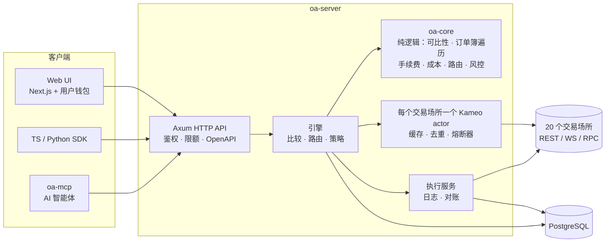
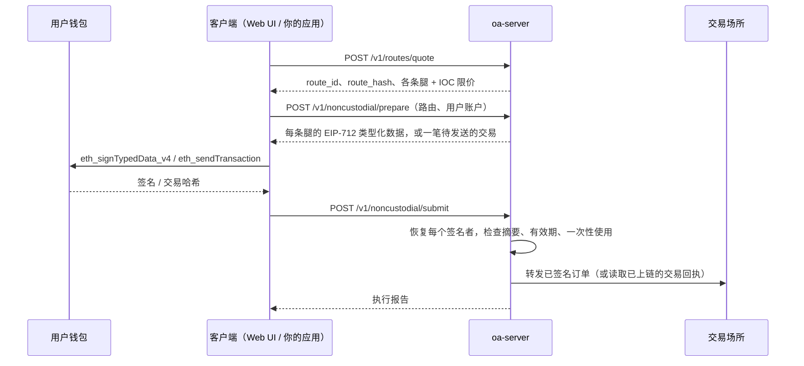

<p align="center">
  
</p>

[English](README.md) · [Русский](README.ru.md) · **简体中文**

**在链上交易场所、中心化交易所和预测市场之间为加密期权寻找最优执行——每一笔订单都由用户自己的钱包签名。**

Omni Strike 只回答一个问题：*对于这个期权、这个方向和这个数量，当前真正能成交的最低价格在哪里——各个交易场所之间到底有什么不同？*
它把 20 个在线交易场所统一到同一个合约模型中，按每个场所真实的手续费公式逐档遍历其订单簿；对于经济上并不相同的合约，除非你逐项明确接受每一处差异，否则拒绝进行比较；然后把订单路由到单一场所，或拆分到多个场所。
在链上交易场所，终端用户在自己的钱包中签署每一笔订单：服务器从不持有私钥，也无法转移资金。

[](https://github.com/SKorhacker/omni-strike/actions/workflows/ci.yml)
[](LICENSE)


> **不构成投资建议。不提供任何担保。** 当你以相应方式构建和配置本软件时，它可以在真实的交易场所下真实的订单。在以只读模式以外的任何模式运行之前，请先阅读[安全模型](#安全模型)和[免责声明](#免责声明)。

## 实时演示

<p align="center">
  
</p>

实时追踪器（Web 界面中的 `/live`）持续为一篮子平值附近的 BTC 和 ETH 合约重新报价，
并将最优的合格交易场所与仅使用 Derive 进行比较（含手续费）。
画面录制自一台使用公开市场数据、以只读模式运行的本地服务器。数字为当时 1 BTC / 10 ETH 订单的估算值；
中心化交易所需要用户自己的账户。

---

## 目录

- [功能](#功能)
- [交易场所](#交易场所)
- [工作原理](#工作原理)
- [快速开始](#快速开始)
- [交易模式](#交易模式)
- [API](#api)
- [非托管执行](#非托管执行)
- [SDK 与 MCP](#sdk-与-mcp)
- [面向 AI 智能体](#面向-ai-智能体)
- [配置](#配置)
- [安全模型](#安全模型)
- [测试](#测试)
- [部署](#部署)
- [项目结构](#项目结构)
- [局限性](#局限性)
- [贡献](#贡献) · [许可证](#许可证) · [免责声明](#免责声明)

## 功能

- **比较**同一份合约（标的、看涨/看跌、行权价、到期时刻）在所有挂牌该合约的交易场所上的价格：给出按*你的*数量计算的总成本（订单簿逐档遍历 + 手续费），而不是盘口最优价。
- **可比性判定**——`STRICTLY_COMPARABLE`、`ECONOMICALLY_SIMILAR_WITH_DIFFERENCES`、`NOT_COMPARABLE`、`INSUFFICIENT_INFORMATION`——并附带原因代码（结算指数、结算时间窗口、权利金币种、行权方式……）。只有在调用方逐项接受每一处差异之后，各交易场所才会相互排名。
- **未知成本绝不按零计算。** 手续费或结算成本未知的交易场所会被排除在路由之外，并返回排除原因。
- **路由**买单：发往最便宜的单一交易场所，或在节省的金额超过额外固定手续费时拆分到 2–3 个交易场所。每条腿都会得到一个 IOC 限价。
- **多腿策略**（1–6 条腿）：每条腿各自选择最优场所 vs. 全部放在同一个场所，并检查最大亏损。
- **二元期权 vs 期权**：将预测市场的二元合约（Kalshi、Hyperliquid HIP-4、Limitless、Myriad）与在每种情形下赔付都不低于它的最便宜的期权垂直价差进行比较。
- **非托管执行**：服务器准备好精确的 EIP-712 载荷或交易，由用户的钱包签名或发送，服务器验证签名者后再转发。
- 基于 Server-Sent Events 的**实时价格**、带 HMAC 签名的 **webhook**、**按集成方分配的 API 密钥和限额**、根据各交易场所条款编制的**地域限制**。
- 同一个引擎支撑 **HTTP API**（OpenAPI 3）、**Web UI**、**TypeScript 和 Python SDK**，以及供 AI 智能体使用的 **MCP 服务器**。

## 交易场所

报价来自 20 个已集成的连接器（公开行情数据，无需密钥）。另有 8 个平台已登记在册，并注明了未集成的原因（`GET /v1/platforms`）。

| 交易场所 | 类型 | 报价 | 执行 |
|---|---|---|---|
| Derive (v3) | 链上订单簿 | ✅ REST + WebSocket | 非托管 (EIP-712) · Web 钱包 · 测试网 |
| Aevo | 链上订单簿 | ✅ | 非托管 (EIP-712 + 集成方 HMAC) · 测试网 |
| Paradex | Starknet 订单簿 | ✅ | 非托管 (SNIP-12) |
| Thetanuts V4 | 链上 RFQ 订单簿 (Base) | ✅ | 非托管交易 · Web 钱包 |
| CallPut | 链上资金池 (Base) | ✅ | 非托管交易 · Web 钱包 |
| Hypercall | Hyperliquid 期权 | ✅ | 非托管 (EIP-712) |
| Hegic | 链上 (Arbitrum) | ✅ 仅卖价 | — |
| Rysk | 链上 RFQ | ✅ 指示性报价，仅展示，从不参与路由 | — |
| Deribit | CEX (USDC 线性) | ✅ REST + WebSocket | 测试网 (API 密钥) |
| OKX | CEX | ✅ REST + WebSocket | 模拟交易 (API 密钥) |
| Bybit | CEX (USDT) | ✅ REST + WebSocket | 测试网 (API 密钥) |
| Binance | CEX (USDT) | ✅ REST + WebSocket | — |
| Bullish, Coincall, Gate, Delta Exchange | CEX | ✅ | — |
| Kalshi | 二元期权（受监管） | ✅ | — |
| Hyperliquid HIP-4 | 二元期权（链上） | ✅ | 非托管 (EIP-712) |
| Limitless | 二元期权（链上） | ✅ | 非托管 (EIP-712 + 集成方 HMAC) |
| Myriad | 二元期权（链上） | ✅ | — |

以 USDT 计价的交易场所在排名前会按实时汇率换算为 USDC。默认标的：BTC、ETH、SOL、XRP、HYPE（`OA_UNDERLYINGS`）。

## 工作原理



1. **连接器**（`crates/adapters`）把每个交易场所原生的合约目录和订单簿转换为统一的规范模型，同时保留原生 id 和每一项合约条款。
2. **交易场所 actor**（`crates/app/src/venue.rs`）为每个场所维护一个有界缓存，对进行中的请求去重，保持 WebSocket 订单簿处于热状态，并在连续失败或遇到 HTTP 429 时打开熔断器。请求失败会替换缓存中的值：绝不会悄无声息地返回过期数据。
3. **核心**（`crates/core`，无 I/O）判定可比性，按请求数量遍历订单簿，套用该场所的手续费公式，进行排名，构建路由并检查风控限额。
4. **执行**模块在进入下一步*之前*把每一次状态转换写入 Postgres 日志；结果未知的订单会通过交易场所进行对账，绝不重新提交。

**每一个机制都有对应的图示**——可比性、成本、路由、风控检查、模式、钱包流程、订单生命周期、熔断器、部署：[docs/diagrams.zh-CN.md](docs/diagrams.zh-CN.md)。
详细说明：[docs/architecture.md](docs/architecture.md)、[docs/routing.md](docs/routing.md)、[docs/comparability.md](docs/comparability.md)。

## 快速开始

环境要求：Rust（锁定的 1.92 工具链会根据 `rust-toolchain.toml` 自动安装）、PostgreSQL 16，UI 需要 Node.js 24 + pnpm 10。在 Windows 上，请在 PowerShell 或 CMD 中使用 MSVC 工具链构建。

```sh
git clone https://github.com/SKorhacker/omni-strike.git && cd omni-strike

# 1. A database (Docker shown; any PostgreSQL 16 works)
export OA_PG_PASSWORD=$(openssl rand -hex 16)
docker compose up -d                      # Postgres on 127.0.0.1:5433

# 2. Configuration
cp .env.example .env
sed -i "s/CHANGE_ME/$OA_PG_PASSWORD/" .env   # DATABASE_URL

# 3. API (read-only mode, loopback only; migrations run at startup)
cargo run --release -p oa-app --bin oa-server        # http://127.0.0.1:8080

# 4. Web UI
cd web && pnpm install --frozen-lockfile && pnpm dev # http://localhost:3000
```

第一个请求：

```sh
curl -s -X POST http://127.0.0.1:8080/v1/quotes/compare \
  -H 'content-type: application/json' \
  -d '{"underlying":"BTC","option_kind":"call","strike":"120000","expiry":"2026-12-25T08:00:00Z",
       "side":"buy","quantity":"1",
       "accepted_differences":["SETTLEMENT_INDEX_DIFFERS","SETTLEMENT_WINDOW_UNKNOWN",
                               "SETTLEMENT_WINDOW_DIFFERS","SETTLEMENT_ASSET_DIFFERS",
                               "PREMIUM_CURRENCY_DIFFERS"]}'
```

请选择当天仍在挂牌的行权价和到期日（`GET /v1/instruments?underlying=BTC`）。所有小数一律以字符串表示。交互式文档：`GET /docs`；规范：`GET /openapi.json`。

## 交易模式

执行能力**在编译时和启动时**决定，绝不由请求决定。

| 模式 | 构建 | 能做什么 |
|---|---|---|
| `READ_ONLY`（默认） | 默认 | 报价、比较、路由。下单端点返回 `403 EXECUTION_DISABLED`。 |
| `SIMULATION` | 默认 | + 基于记录的订单簿进行模拟成交，结果持久化且可重放。 |
| `TESTNET` | `--features testnet` | 在交易场所的**测试网**上使用服务器持有的测试密钥下真实订单。使用独立的 env 文件和数据库（名称必须包含 `testnet`）。 |
| `MAINNET_NONCUSTODIAL` | `--features mainnet-nc` | **由终端用户签名**的真实主网订单。服务器不持有任何密钥。使用独立的 env 文件和数据库（名称必须包含 `mainnet_nc`）。紧急停止开关默认开启。 |
| `LIVE`（托管） | — | 不存在。`--features live` 会故意触发编译错误。 |

`testnet` 和 `mainnet-nc` 不能同时启用。参见 [docs/testnet.md](docs/testnet.md) 和 [docs/mainnet-noncustodial.md](docs/mainnet-noncustodial.md)。

## API

服务器在 `GET /docs` 提供的交互式参考文档（由 Rust 类型自动生成）：

<p align="center">
  
</p>

| 端点 | 用途 |
|---|---|
| `GET /v1/platforms` | 所有平台、其集成程度、能力以及缺失的部分 |
| `GET /v1/instruments` | 按标的 / 交易场所列出的挂牌合约 |
| `POST /v1/quotes/compare` | 针对一份合约和数量对交易场所排名 |
| `POST /v1/comparability/explain` | 两份合约为何可比（或不可比） |
| `POST /v1/routes/preview` · `POST /v1/orders/simulate` | 最优目的地；模拟成交（可重放：`GET/POST /v1/simulations/{id}[/replay]`） |
| `POST /v1/routes/quote` | 可执行路由：交易场所、数量、IOC 限价、一次性的 `route_id` + `route_hash`（30 秒） |
| `POST /v1/strategies/quote` · `POST /v1/strategies/route` | 多腿策略 |
| `POST /v1/binaries/compare` | 二元期权 vs 超复制期权价差 |
| `GET /v1/stream/quotes` | 实时最优价格 (SSE) |
| `POST /v1/noncustodial/prepare` · `POST /v1/noncustodial/submit` | 非托管执行 |
| `POST /v1/noncustodial/orders` | 调用方自己的订单（钱包签名） |
| `POST /v1/noncustodial/derive/subaccounts` · `…/derive/account` | 调用方的 Derive 子账户、余额和持仓（钱包签名，只读） |
| `POST /v1/routes/execute-testnet` · `GET /v1/orders[/{id}]` · `GET /v1/exec-stats` | 测试网执行和订单日志 |
| `GET /v1/integrator/me` · `PUT /v1/integrator/settings` | 集成方自助服务 |
| `/v1/admin/integrators…` | 运营方端点（管理员 token） |
| `GET /health/live` · `GET /health/ready` · `GET /v1/metrics` | 健康检查和指标 |

所有错误使用同一种封装格式：`{"error": {"code": "…", "message": "…"}}`。包含请求体和 webhook 签名方案的完整指南见 [docs/integrators.md](docs/integrators.md)（也可通过 `GET /docs` 访问）。

## 非托管执行



- 服务器构建载荷；由**用户的钱包**签名。服务器从每个签名中恢复签名者，凡是与 prepare 时声明的账户不一致的，一律拒绝，且发生在任何内容到达交易场所之前。
- EIP-712 domain 取自所接入的交易场所（chain id），绝不使用默认值：测试网签名无法在主网上重放，反之亦然。
- 已准备的执行存储在 Postgres 中，在所有实例之间只会被取用恰好一次。
- 订单均为 IOC 限价单：要么立即成交，要么被交易场所撤销。不会有任何挂单留在订单簿上。
- 交易类场所（Thetanuts、CallPut）：由钱包自己发送交易；服务器只读取公开的交易回执，并检查它与所准备的调用完全一致。USDC 授权是精确金额，并且只在当前授权额度不足时才会请求。
- 上限（单笔订单上限以及滚动时间窗口内的上限，从订单日志中读取）和紧急停止开关在整个服务器范围内生效。该模式下禁止卖出。

Web UI 为 Derive、Thetanuts 和 CallPut 实现了浏览器端流程，支持任何 EIP-6963 钱包（MetaMask、Rabby、Coinbase Wallet……），且不依赖任何钱包库。其他交易场所需要客户端侧的密钥（Aevo、Limitless HMAC）或 Starknet 账户（Paradex），需通过 SDK 使用。

## SDK 与 MCP

- **TypeScript** — [`sdk/typescript`](sdk/typescript/README.md)，零运行时依赖。
- **Python** — [`sdk/python`](sdk/python/README.md)，仅使用标准库，小数以 `Decimal` 表示。
- **MCP** — `oa-mcp` 是一个 stdio MCP 服务器，向 AI 智能体提供报价、路由、模拟和订单状态；它转发到 HTTP API，因此使用相同的校验和限额。不存在主网执行工具；通过 MCP 进行测试网执行默认关闭，除非显式启用。参见 [docs/mcp.md](docs/mcp.md)。

```ts
import { OmniStrike } from "@omni-strike/sdk";
const os = new OmniStrike({ baseUrl: "http://127.0.0.1:8080", apiKey: process.env.OMNI_KEY });
const q = await os.compareQuotes({ underlying: "ETH", option_kind: "call", strike: "4000",
  expiry: "2026-12-25T08:00:00Z", side: "buy", quantity: "10", accepted_differences: [] });
console.log(q.ranked[0]);
```

## 面向 AI 智能体

本仓库经过专门设置，智能体无需猜测即可使用本产品并修改代码。

| 你想要…… | 使用 |
|---|---|
| 让智能体**为期权报价和路由** | MCP 服务器（`oa-mcp`，[docs/mcp.md](docs/mcp.md)）或技能 [`.claude/skills/omni-strike-api`](.claude/skills/omni-strike-api/SKILL.md) |
| 让编程智能体**安全地修改代码** | [AGENTS.md](AGENTS.md)：目录结构、命令、规则、各部分所在位置（Claude Code、Codex、Cursor、Copilot 等均会读取） |
| 为智能体提供**分步操作流程** | [`.claude/skills/`](.claude/skills) 中的技能：`add-venue`、`verify`、`omni-strike-api` |
| 把文档提供给模型 | [`llms.txt`](llms.txt)：文档的简短索引，采用 llmstxt.org 格式 |

## 配置

服务器读取 `.env`（或由 `OA_ENV_FILE` 指定的文件）。模板：[`.env.example`](.env.example)、[`.env.testnet.example`](.env.testnet.example)、[`.env.mainnet-nc.example`](.env.mainnet-nc.example)、[`deploy/.env.example`](deploy/.env.example)。

| 变量 | 默认值 | 含义 |
|---|---|---|
| `DATABASE_URL` | —（必填） | PostgreSQL URL。绝不写入日志。 |
| `OA_TRADING_MODE` | `READ_ONLY` | `READ_ONLY`、`SIMULATION`、`TESTNET`*、`MAINNET_NONCUSTODIAL`*（*仅限对应的构建） |
| `OA_BIND` | `127.0.0.1:8080` | 非回环地址会被拒绝，除非设置了 `OA_API_TOKEN` |
| `OA_API_TOKEN` | — | 设置后，每次 API 调用都必须携带该 Bearer token |
| `OA_REQUIRE_API_KEY` | `false` | API 调用必须携带按集成方分配的密钥 |
| `OA_PUBLIC_RPS` | 10 | 对没有集成方密钥的调用方按客户端 IP 限速（0 = 关闭；回环地址豁免） |
| `OA_ADMIN_TOKEN` | — | 启用 `/v1/admin/*`（≥ 24 个字符，否则忽略） |
| `OA_KILL_SWITCH` | on | 除非精确设置为 `false`，否则拒绝所有订单 |
| `OA_MAINNET_MAX_ORDER_USD` / `OA_MAINNET_MAX_SESSION_USD` | 100 / 500 | 服务器范围的上限（硬性上限 25 000 / 100 000） |
| `OA_SESSION_WINDOW_HOURS` | 24 | 会话上限的滚动时间窗口（1–720） |
| `OA_<VENUE>_NONCUSTODIAL` | `false` | 接入一个由用户签名的交易场所（`DERIVE`、`AEVO`、`PARADEX`、`THETANUTS`、`CALLPUT`、`HYPERCALL`、`HYPERLIQUID`、`LIMITLESS`） |
| `OA_REQUIRE_USER_COUNTRY` | `false` | 可执行路由必须提供 `user_country` |
| `OA_GEO_POLICY_FILE` | 内置 | 覆盖 [`config/geo-policy.json`](config/geo-policy.json) |
| `OA_UNDERLYINGS` | `BTC,ETH,SOL,XRP,HYPE` | 要加载的标的 |
| `OA_LATENCY_BUDGET_MS` | 220 | 每次比较中等待未缓存的交易场所订单簿的最长时间 |
| `OA_REQUEST_TIMEOUT_MS`, `OA_MAX_INFLIGHT`, `OA_MAX_CONCURRENT_COMPARES`, `OA_DB_MAX_CONNECTIONS` | 见代码 | 负载限制 |
| `OA_LIVE`, `OA_HOT_REFRESH`, `OA_BULK_TOPS` | on | 后台价格跟踪和刷新（设为 `off` 可关闭） |
| `OA_SIMULATION_RETENTION_DAYS` | 30 | 超过该天数的模拟结果每小时清理一次（过期的路由报价和已准备的执行在 1 天后清理；订单日志保留） |
| `OA_WEBHOOK_ALLOW_LOCAL` | `false` | 仅用于开发：接受 `http://localhost` webhook URL |
| `OA_LOG_FORMAT`, `RUST_LOG` | text, `info` | 设为 `json` 则每行输出一个 JSON 对象 |

测试网密钥（`OA_DERIVE_TESTNET_*`、`OA_AEVO_TESTNET_*`、`OA_BYBIT_TESTNET_*`、`OA_DERIBIT_TESTNET_*`、`OA_OKX_DEMO_*`）只会被 `testnet` 构建读取。

## 安全模型

- **不托管资产。** 任何构建都无法持有用户的主网私钥；主网接入函数无法访问任何密钥加载器。托管式实盘交易无法通过编译。
- **执行层面的纵深防御：** 编译期 feature 门控；启动检查（模式、数据库名称、绑定地址、token 强度、残留的占位符）；紧急停止开关默认开启；基于日志的服务器范围上限在提交时再次检查（未签名的准备不计入）；一次性且与哈希绑定的路由（30 秒）；签名有效期 5 分钟，并在已准备的执行被消费之前完成验证；一次性提交；仅 IOC；主网仅允许买入。
- **Web UI 会检查它所签署的内容：** 它会拒绝针对其他合约或钱包的类型化数据、发往未知合约的交易、非预期的 ETH 金额，以及超过已签名最差成本的 USDC 授权——即使服务器已被攻破也是如此。
- **短期有效的用户凭证只使用一次，且绝不写入日志**（Derive REST 认证签名、Paradex JWT、Aevo HMAC）。需要钱包签名的读取端点在转发任何内容之前会先在本地验证签名。
- **私有日志：** 在主网上，订单日志不可被列出；每个用户凭钱包签名读取自己的订单。
- **网络暴露面：** 默认绑定回环地址；非回环地址需要 token；请求体大小、并发、按集成方和按 IP 的速率限制；webhook 只能发往公网主机（不跟随重定向，DNS 固定）；容器以非 root 用户运行并移除所有 capabilities；Caddy 拦截 `/v1/admin`，并且只代理 UI 需要的端点。
- **不可信数据：** 交易场所提供的文本一律视为数据（MCP 结果会加上提示前缀）；小数绝不经过浮点数。

请私下报告漏洞：参见 [SECURITY.md](SECURITY.md)。

## 测试

```sh
cargo test --workspace                       # offline: no network, no database, cannot trade
cargo test -p oa-app --features mainnet-nc   # mainnet non-custodial build
cargo clippy --workspace --all-targets -- -D warnings   # also with --features testnet / mainnet-nc
cd web && pnpm lint && pnpm exec tsc --noEmit && pnpm build
cd sdk/typescript && npx -p typescript tsc -p . && npm test ; cd ../python && python -m pytest -q
```

- 交易场所解析器针对**录制的真实响应**进行测试（`fixtures/recorded-*`）。
- 签名针对由各交易场所自己的库生成的**参考向量**进行测试（`fixtures/*_vector*.json`，生成脚本位于 `scripts/gen_*_vectors.py`），并用 `eth_abi` / `eth_account` 交叉验证（`scripts/check_*.py`）。
- 完整的 prepare → sign → submit 流程在 `crates/app/src/e2e_tests.rs` 中针对本地模拟交易场所运行。
- 可选：`--features live-tests` 访问真实的公开端点（只读）；`OA_TEST_DATABASE_URL=… cargo test -p oa-app pg_tests` 针对真实的 Postgres 运行存储层测试；`scripts/e2e_live.py` 驱动一个正在运行的完整服务栈，包括 MCP 可执行文件。
- `cargo run --release -p oa-app --bin oa-bench` 重放录制的订单簿，在无网络的情况下测量引擎性能；`oa-load` 对正在运行的服务器进行负载测试。

## 部署

Docker 镜像（`Dockerfile`、`deploy/web.Dockerfile`）、带 Caddy（自动 HTTPS）和 Prometheus 的单节点 Compose 服务栈，以及一个使用独立数据库的主网非托管专用服务栈：[docs/deployment.md](docs/deployment.md)。`deploy/vps-bootstrap.sh` 用于加固一台全新的 Ubuntu/Debian 主机（防火墙、fail2ban、仅允许密钥登录的 SSH、无人值守升级）。

## 项目结构

```
crates/
  core/       pure domain logic: comparability, book walk, fees, cost, routing, risk (no I/O)
  adapters/   venue connectors (market data) and execution venues (*_exec custodial testnet,
              *_user non-custodial), shared HTTP client, platform registry
  app/        engine, Kameo venue actors, execution service, Axum API, OpenAPI, MCP, Postgres store
    migrations/   forward-only, non-destructive SQL, embedded and applied at startup
    src/bin/      oa-server, oa-mcp, oa-bench, oa-load
web/          Next.js UI (compare, route, wallet execution, my orders)
sdk/          TypeScript and Python clients, OpenAPI drift check
config/       geo policy compiled from venue terms
fixtures/     recorded venue responses and signing vectors for offline tests
scripts/      signing-vector generators, ABI cross-checks, testnet and first-order helpers
deploy/       Compose stacks, Caddy, Prometheus, VPS bootstrap
docs/         diagrams, architecture, routing, comparability, API guide, deployment, modes, MCP
.claude/skills/  step-by-step procedures for AI agents (use the API, add a venue, verify)
```

## 局限性

- 报价根据公开订单簿计算：在交易场所实际成交之前，报价只是估计值。
- 拆单的各条腿在不同交易场所之间不具备原子性；每条腿都是 IOC，部分完成的拆单会被报告，而不会重新路由。
- 部分交易场所公布的手续费表不完整；在缺失的成本明确之前，它们会被排除在路由之外。
- 非托管订单仍然从服务器的 IP 到达交易场所：各场所的地域规则依然适用（`config/geo-policy.json`），运营方仍需对其服务的司法辖区负责。`user_country` 由客户端声明：地域过滤的可靠程度取决于设置它的集成方。
- 每会话上限是服务器范围的，而不是按用户计算。

## 贡献

欢迎提交 issue 和 pull request——参见 [CONTRIBUTING.md](CONTRIBUTING.md)。添加交易场所：在 `crates/adapters` 中实现 `Connector`，添加录制的 fixture 和解析器测试，并在 `crates/app/src/bin/server.rs` 和 `crates/adapters/src/registry.rs` 中注册。

## 许可证

[MIT](LICENSE)。

## 免责声明

本项目按原样提供，不附带任何形式的担保。它不构成投资建议，也不构成任何金融服务的要约。期权和预测市场可能损失 100% 的权利金。任何运行本项目的人都有责任遵守其所在司法辖区的法律和各交易场所的服务条款，并在将资金托付给代码之前自行审查代码。
