# How Omni Strike works, in diagrams

Every diagram below describes the code as it is; the file that implements each step is named under
it. GitHub renders the Mermaid blocks directly.

1. [System overview](#1-system-overview)
2. [One comparison, end to end](#2-one-comparison-end-to-end)
3. [Comparability verdict](#3-comparability-verdict)
4. [Cost of an order on one venue](#4-cost-of-an-order-on-one-venue)
5. [Routing: single venue or split](#5-routing-single-venue-or-split)
6. [Risk checks](#6-risk-checks)
7. [Trading modes and gates](#7-trading-modes-and-gates)
8. [Non-custodial execution](#8-non-custodial-execution)
9. [What the web UI accepts to sign](#9-what-the-web-ui-accepts-to-sign)
10. [Order lifecycle](#10-order-lifecycle)
11. [Venue actor: cache and circuit breaker](#11-venue-actor-cache-and-circuit-breaker)
12. [Deployment](#12-deployment)

## 1. System overview

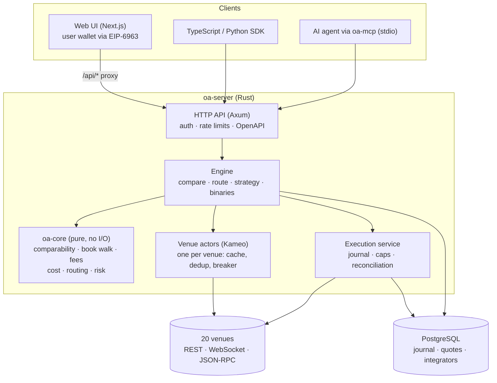

`crates/core` · `crates/adapters` · `crates/app` (`engine.rs`, `venue.rs`, `execution.rs`, `api.rs`)

## 2. One comparison, end to end

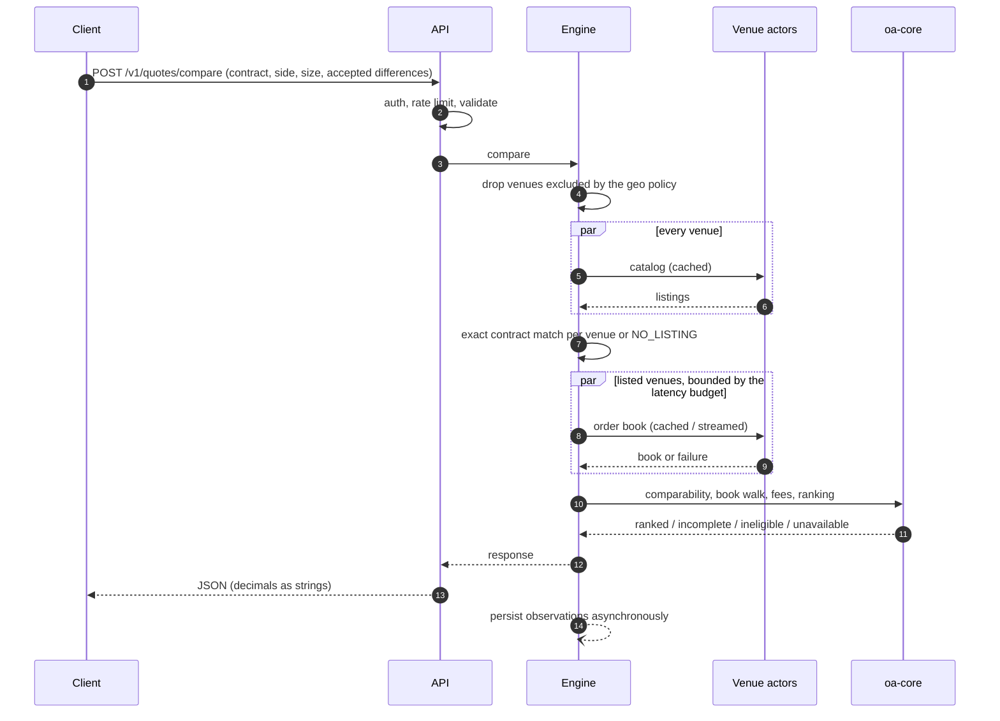

`engine.rs::compare`, `core/cost.rs`, `core/comparability.rs`

## 3. Comparability verdict

Two contracts are compared term by term. Ranking across venues only happens for
`STRICTLY_COMPARABLE`, or for `ECONOMICALLY_SIMILAR_WITH_DIFFERENCES` when the caller accepted
every difference code.

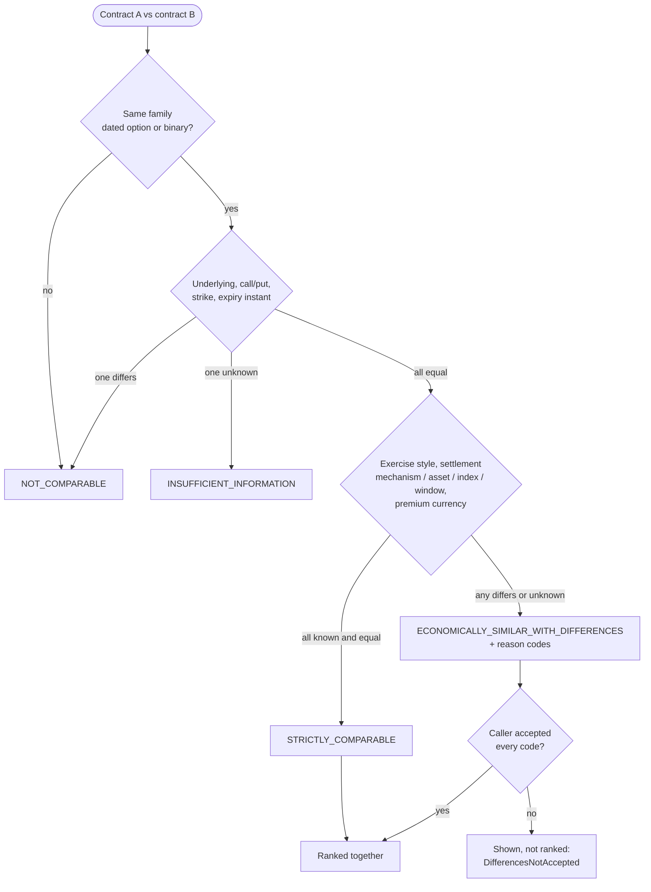

Contract-size multipliers are normalised away, never a reason. `core/comparability.rs`

## 4. Cost of an order on one venue

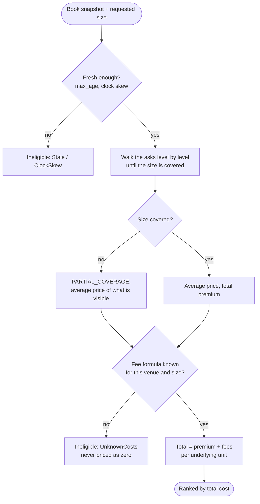

`core/book.rs`, `core/fees.rs`, `core/cost.rs`

## 5. Routing: single venue or split

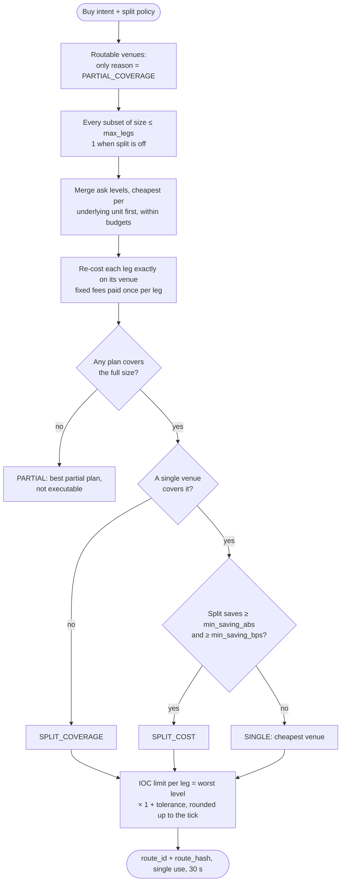

`core/routing.rs`, `engine.rs::route_quote` — details in [routing.md](routing.md)

## 6. Risk checks

Every check runs and every violation is returned (no short-circuit), before anything is sent.

```mermaid
flowchart LR
  I([Order intent]) --> C1[Kill switch]
  C1 --> C2[Mode allows submission]
  C2 --> C3[Venue, network, underlying,<br/>family allowed]
  C3 --> C4[Sell allowed?<br/>off on mainnet]
  C4 --> C5[Quantity > 0, limit > 0]
  C5 --> C6[Worst cost ≤ per-order cap]
  C6 --> C7[Committed spend + this order<br/>≤ window cap]
  C7 --> C8[Limit within max deviation<br/>of the reference price]
  C8 --> C9[Strategy max loss bounded]
  C9 --> OK{Any violation?}
  OK -- yes --> REJ([Refused with the list])
  OK -- no --> GO([Journaled, then sent])
```

`core/risk.rs`, `engine.rs::risk_limits`; the window cap is checked again at submission under a
lock (`execution.rs::reserve_session_spend`).

## 7. Trading modes and gates

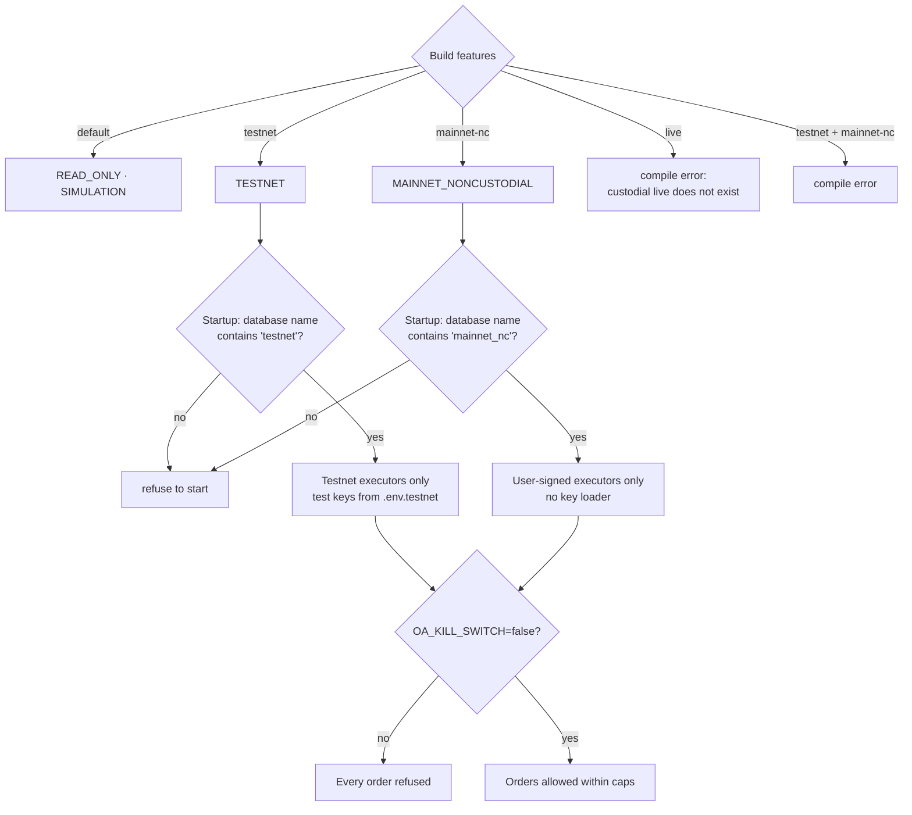

`crates/app/src/lib.rs`, `config.rs`, `bin/server.rs`

## 8. Non-custodial execution

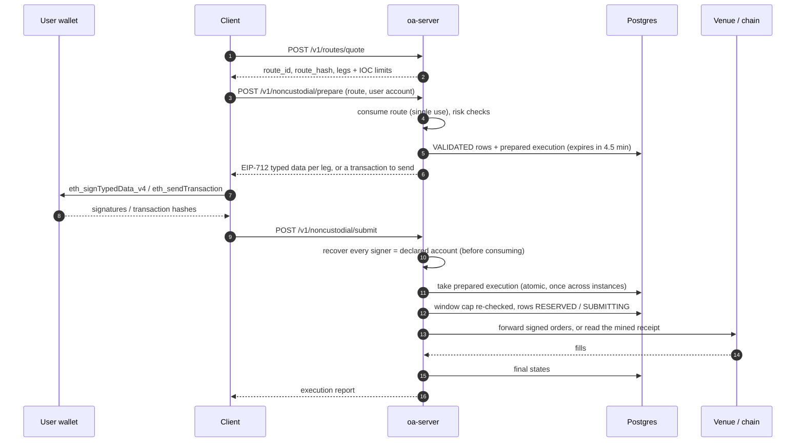

`execution.rs::prepare_user_signed` / `submit_user_signed`, `adapters/src/*_user.rs`

## 9. What the web UI accepts to sign

Even if the server were compromised, the page refuses anything outside these rules.

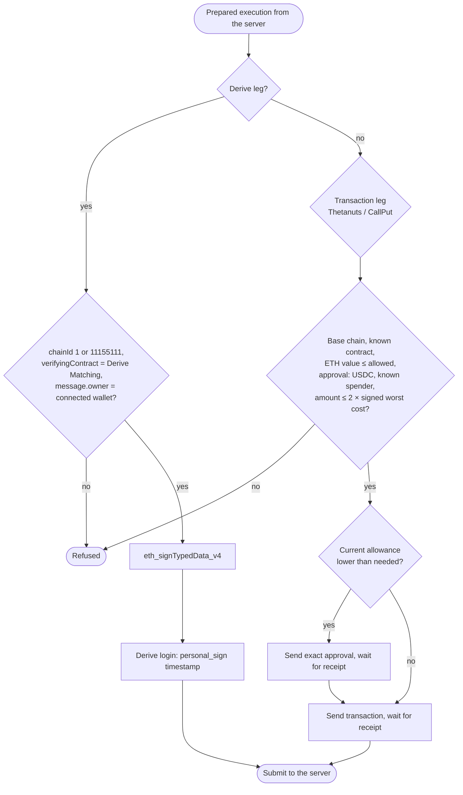

`web/lib/noncustodial.ts`, `web/lib/wallet.ts`

## 10. Order lifecycle

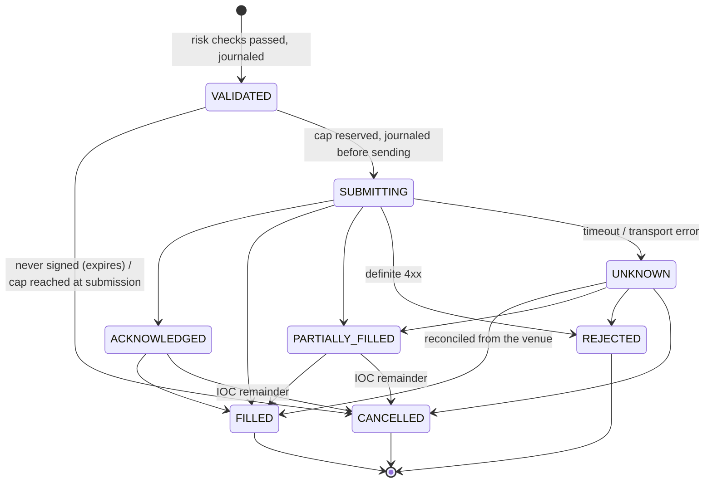

An `UNKNOWN` order is looked up by its precomputed venue id (three quick attempts, then every 10 s,
also after a restart). It is **never resubmitted**. `execution.rs` (`submit_row`, `OrderTracker`)

## 11. Venue actor: cache and circuit breaker

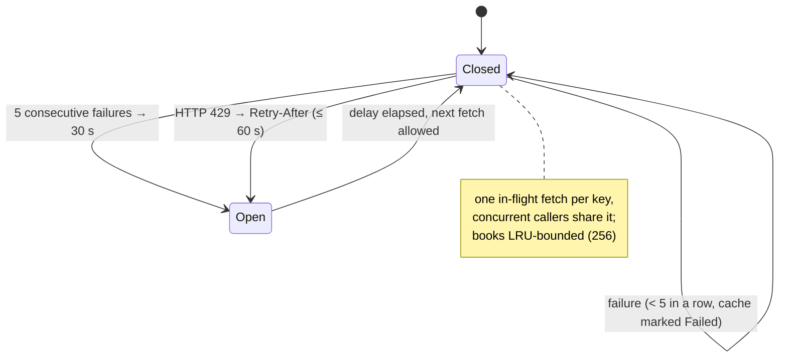

`crates/app/src/venue.rs`

## 12. Deployment

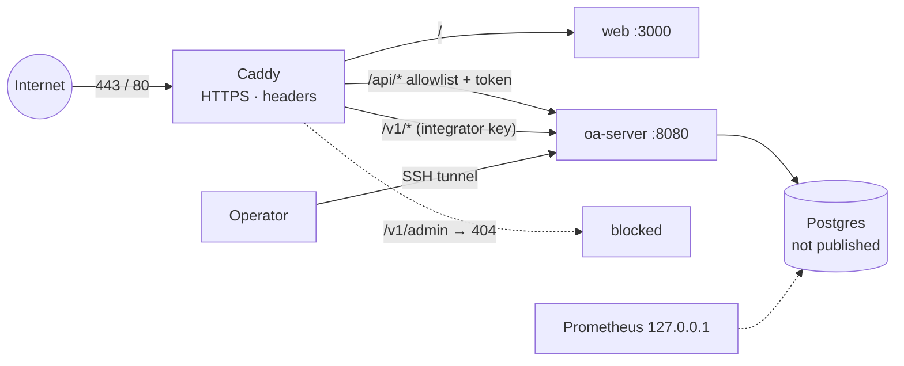

`deploy/docker-compose.yml`, `deploy/Caddyfile*` — details in [deployment.md](deployment.md)
