# Как работает Omni Strike: диаграммы

[English](diagrams.md) · **Русский** · [简体中文](diagrams.zh-CN.md)

Каждая диаграмма ниже описывает код в его текущем виде; под каждой указан файл, реализующий
соответствующий шаг. GitHub отображает блоки Mermaid напрямую.

1. [Обзор системы](#1-обзор-системы)
2. [Одно сравнение от начала до конца](#2-одно-сравнение-от-начала-до-конца)
3. [Вердикт о сопоставимости](#3-вердикт-о-сопоставимости)
4. [Стоимость ордера на одной площадке](#4-стоимость-ордера-на-одной-площадке)
5. [Маршрутизация: одна площадка или разбиение](#5-маршрутизация-одна-площадка-или-разбиение)
6. [Проверки рисков](#6-проверки-рисков)
7. [Режимы торговли и защитные барьеры](#7-режимы-торговли-и-защитные-барьеры)
8. [Некастодиальное исполнение](#8-некастодиальное-исполнение)
9. [Что веб-интерфейс соглашается подписать](#9-что-веб-интерфейс-соглашается-подписать)
10. [Жизненный цикл ордера](#10-жизненный-цикл-ордера)
11. [Актор площадки: кэш и circuit breaker](#11-актор-площадки-кэш-и-circuit-breaker)
12. [Развёртывание](#12-развёртывание)

## 1. Обзор системы

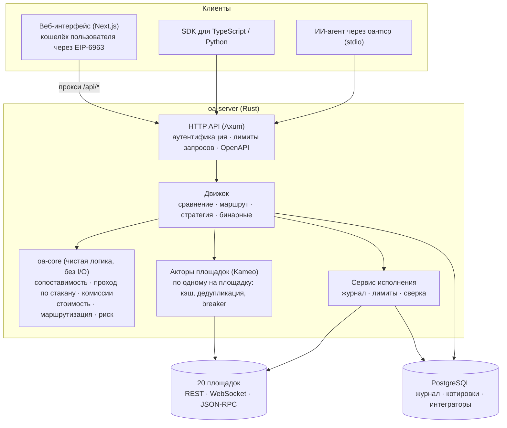

`crates/core` · `crates/adapters` · `crates/app` (`engine.rs`, `venue.rs`, `execution.rs`, `api.rs`)

## 2. Одно сравнение от начала до конца

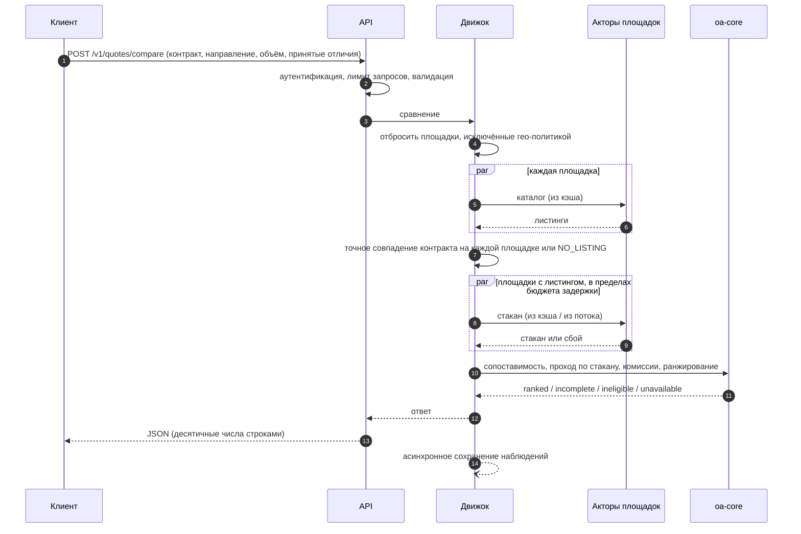

`engine.rs::compare`, `core/cost.rs`, `core/comparability.rs`

## 3. Вердикт о сопоставимости

Два контракта сравниваются по каждому условию. Ранжирование между площадками происходит только для
`STRICTLY_COMPARABLE` или для `ECONOMICALLY_SIMILAR_WITH_DIFFERENCES`, если вызывающая сторона
приняла каждый код отличия.

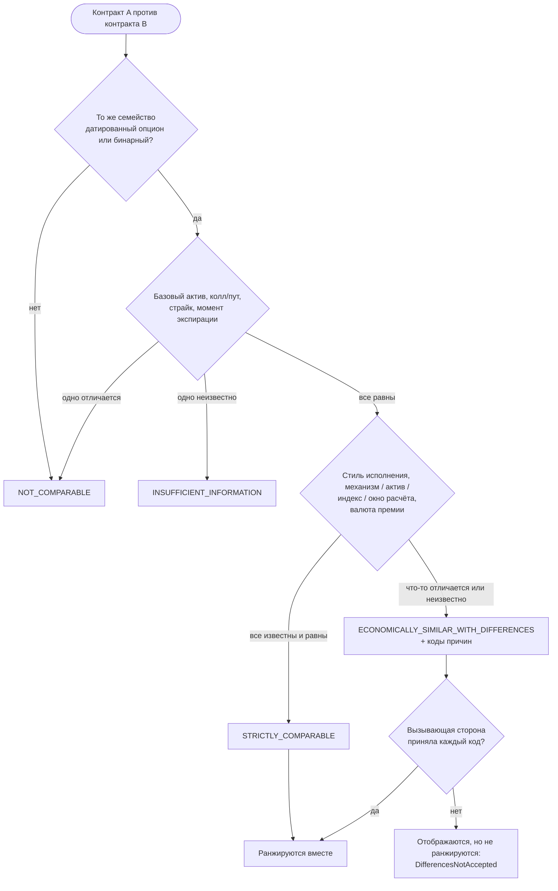

Множители размера контракта нормализуются и никогда не являются причиной. `core/comparability.rs`

## 4. Стоимость ордера на одной площадке

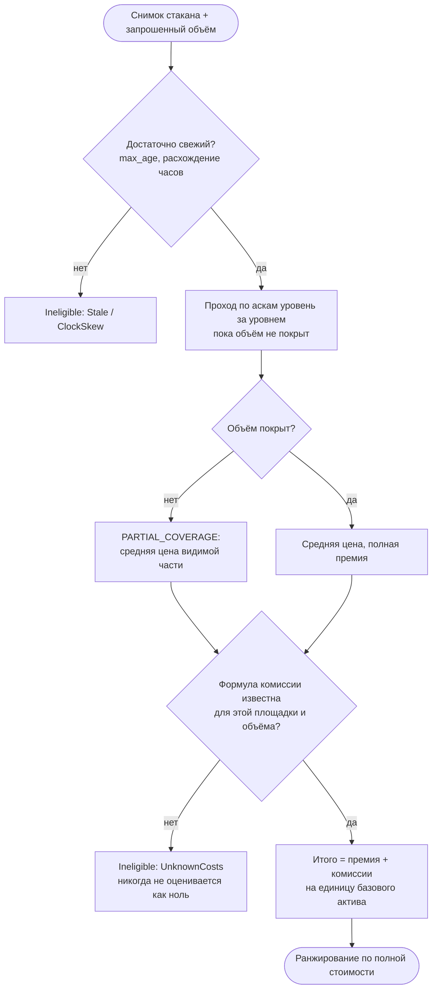

`core/book.rs`, `core/fees.rs`, `core/cost.rs`

## 5. Маршрутизация: одна площадка или разбиение

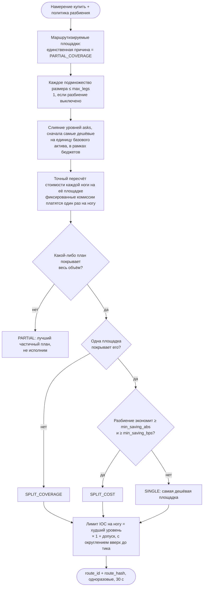

`core/routing.rs`, `engine.rs::route_quote` — подробности в [routing.md](routing.md)

## 6. Проверки рисков

Выполняется каждая проверка и возвращается каждое нарушение (без досрочного выхода), прежде чем
что-либо будет отправлено.

```mermaid
flowchart LR
  I(["Намерение ордера"]) --> C1["Kill switch"]
  C1 --> C2["Режим разрешает отправку"]
  C2 --> C3["Площадка, сеть, базовый актив,<br/>семейство разрешены"]
  C3 --> C4["Продажа разрешена?<br/>выключена в mainnet"]
  C4 --> C5["Количество > 0, лимит > 0"]
  C5 --> C6["Худшая стоимость ≤ лимит на ордер"]
  C6 --> C7["Зарезервированные траты + этот ордер<br/>≤ лимит окна"]
  C7 --> C8["Лимит в пределах максимального отклонения<br/>от референсной цены"]
  C8 --> C9["Максимальный убыток стратегии ограничен"]
  C9 --> OK{"Есть нарушения?"}
  OK -- "да" --> REJ(["Отклонено со списком нарушений"])
  OK -- "нет" --> GO(["Записано в журнал, затем отправлено"])
```

`core/risk.rs`, `engine.rs::risk_limits`; лимит окна повторно проверяется при отправке под
блокировкой (`execution.rs::reserve_session_spend`).

## 7. Режимы торговли и защитные барьеры

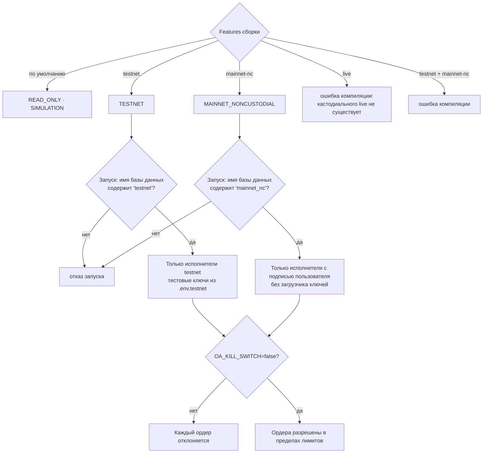

`crates/app/src/lib.rs`, `config.rs`, `bin/server.rs`

## 8. Некастодиальное исполнение

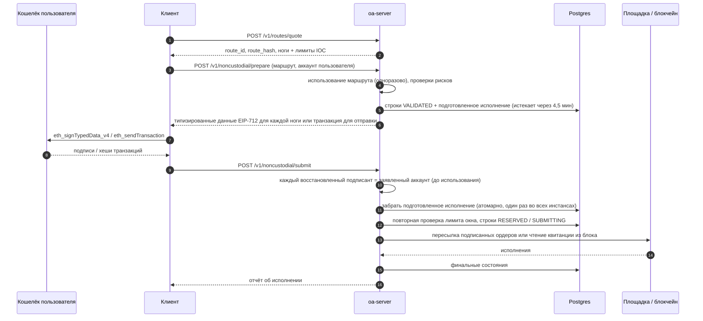

`execution.rs::prepare_user_signed` / `submit_user_signed`, `adapters/src/*_user.rs`

## 9. Что веб-интерфейс соглашается подписать

Даже если сервер скомпрометирован, страница отклоняет всё, что выходит за эти правила.

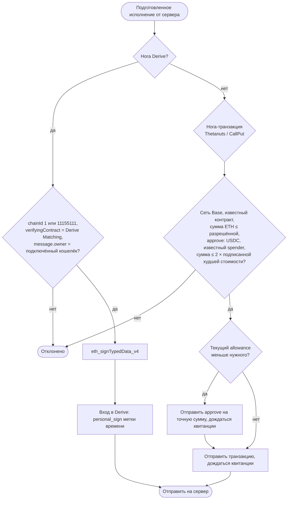

`web/lib/noncustodial.ts`, `web/lib/wallet.ts`

## 10. Жизненный цикл ордера

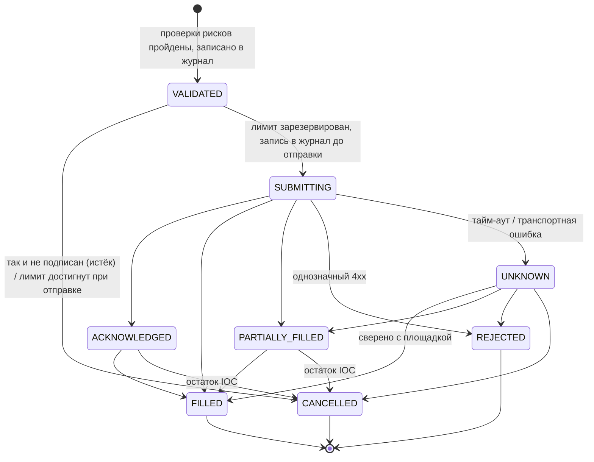

Ордер в состоянии `UNKNOWN` ищется по заранее вычисленному идентификатору на площадке (три быстрые
попытки, затем каждые 10 с, в том числе после перезапуска). Он **никогда не отправляется повторно**.
`execution.rs` (`submit_row`, `OrderTracker`)

## 11. Актор площадки: кэш и circuit breaker

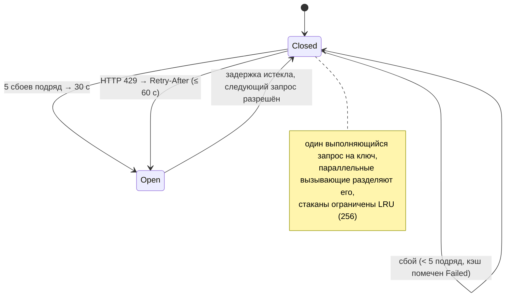

`crates/app/src/venue.rs`

## 12. Развёртывание

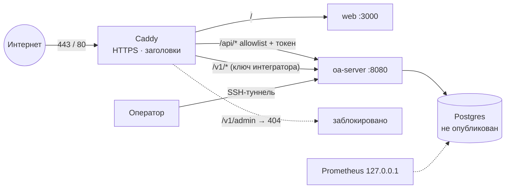

`deploy/docker-compose.yml`, `deploy/Caddyfile*` — подробности в [deployment.md](deployment.md)
