# 图解 Omni Strike 的工作原理

[English](diagrams.md) · [Русский](diagrams.ru.md) · **简体中文**

下面的每张图都按代码的实际情况描述；实现每个步骤的文件名列在图的下方。GitHub 会直接渲染这些 Mermaid 代码块。

1. [系统概览](#1-系统概览)
2. [一次比较的完整流程](#2-一次比较的完整流程)
3. [可比性判定](#3-可比性判定)
4. [单一交易场所上的订单成本](#4-单一交易场所上的订单成本)
5. [路由选择单一场所还是拆单](#5-路由选择单一场所还是拆单)
6. [风控检查](#6-风控检查)
7. [交易模式与准入关卡](#7-交易模式与准入关卡)
8. [非托管执行](#8-非托管执行)
9. [Web UI 接受签署的内容](#9-web-ui-接受签署的内容)
10. [订单生命周期](#10-订单生命周期)
11. [交易场所 actor 的缓存与熔断器](#11-交易场所-actor-的缓存与熔断器)
12. [部署](#12-部署)

## 1. 系统概览

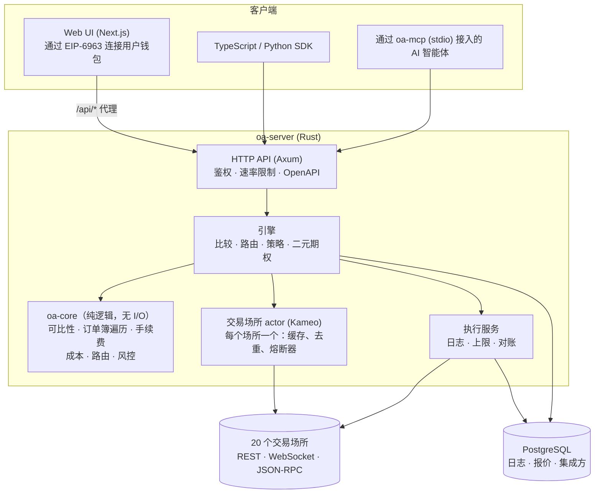

`crates/core` · `crates/adapters` · `crates/app`（`engine.rs`、`venue.rs`、`execution.rs`、`api.rs`）

## 2. 一次比较的完整流程

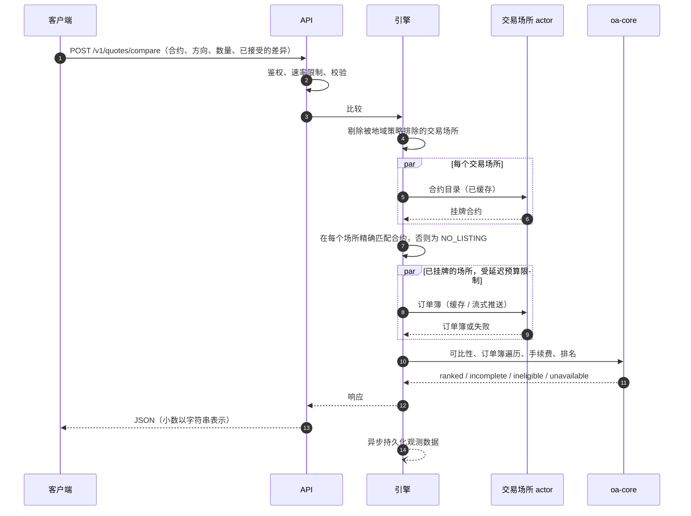

`engine.rs::compare`、`core/cost.rs`、`core/comparability.rs`

## 3. 可比性判定

两份合约逐项条款进行比较。只有在 `STRICTLY_COMPARABLE` 的情况下，或在 `ECONOMICALLY_SIMILAR_WITH_DIFFERENCES` 且调用方接受了每一个差异代码的情况下，才会在交易场所之间进行排名。

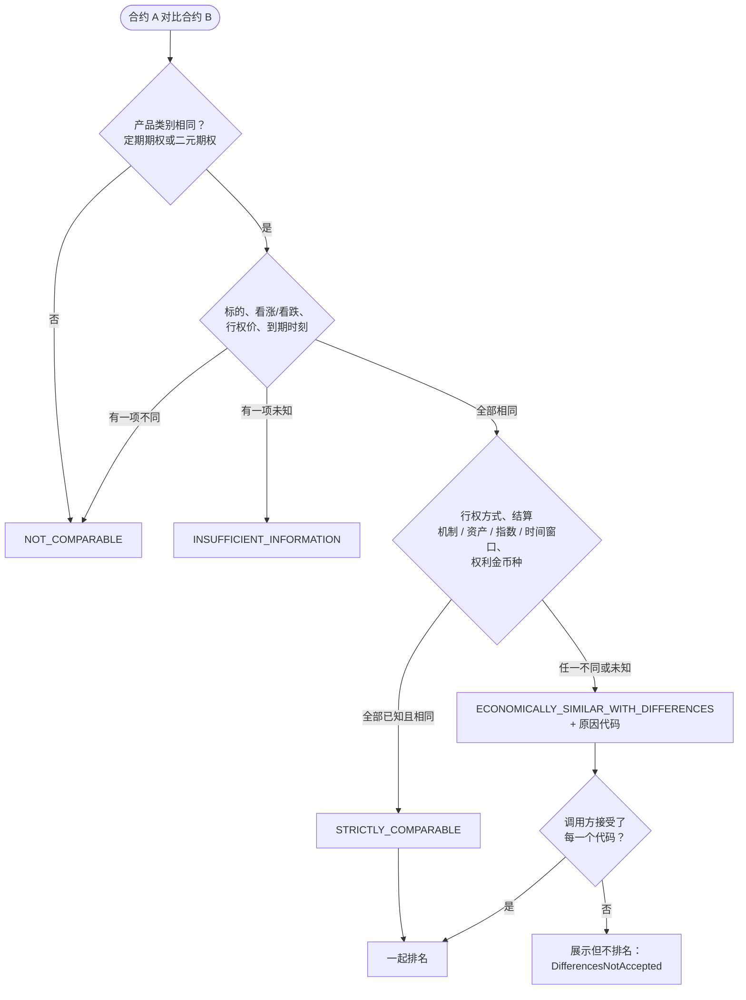

合约乘数会被归一化消除，绝不会成为差异原因。`core/comparability.rs`

## 4. 单一交易场所上的订单成本

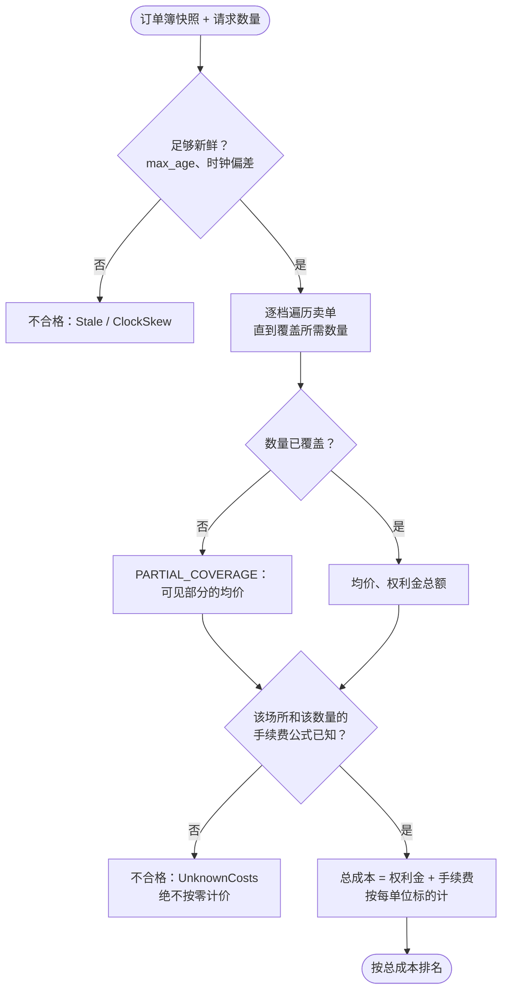

`core/book.rs`、`core/fees.rs`、`core/cost.rs`

## 5. 路由选择单一场所还是拆单

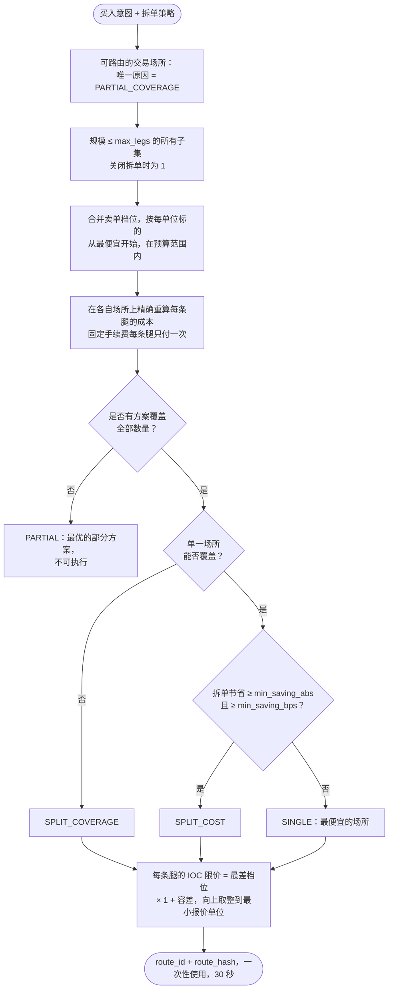

`core/routing.rs`、`engine.rs::route_quote` — 详见 [routing.md](routing.md)

## 6. 风控检查

在发送任何内容之前，所有检查都会执行，并返回所有违规项（不会短路）。

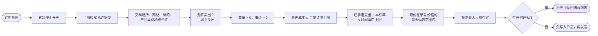

`core/risk.rs`、`engine.rs::risk_limits`；时间窗口上限会在提交时于锁内再次检查（`execution.rs::reserve_session_spend`）。

## 7. 交易模式与准入关卡

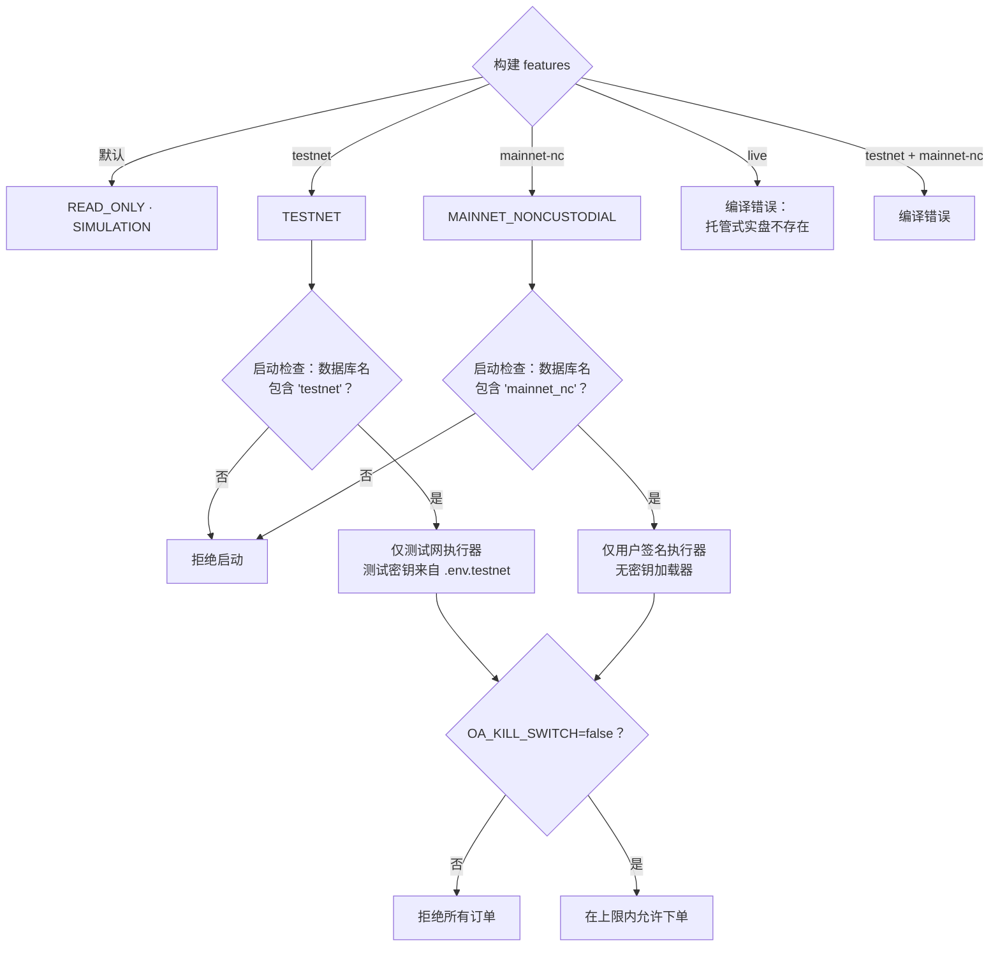

`crates/app/src/lib.rs`、`config.rs`、`bin/server.rs`

## 8. 非托管执行

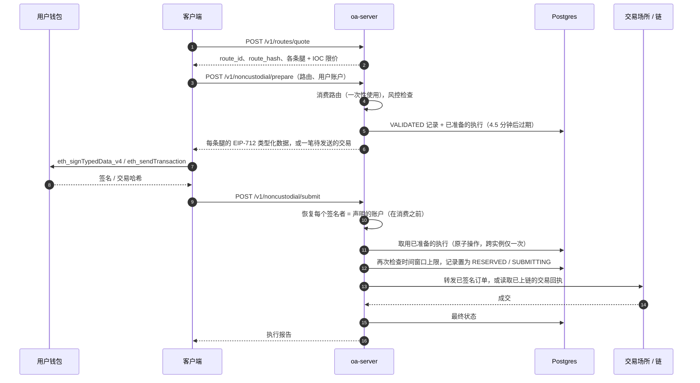

`execution.rs::prepare_user_signed` / `submit_user_signed`、`adapters/src/*_user.rs`

## 9. Web UI 接受签署的内容

即使服务器已被攻破，页面也会拒绝任何不符合以下规则的内容。

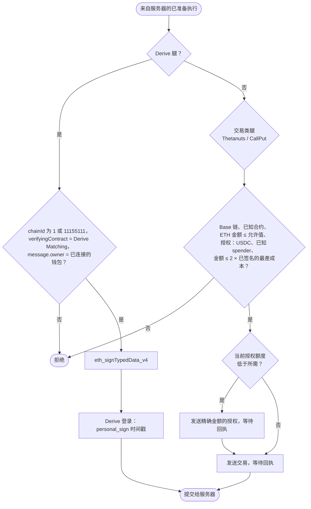

`web/lib/noncustodial.ts`、`web/lib/wallet.ts`

## 10. 订单生命周期

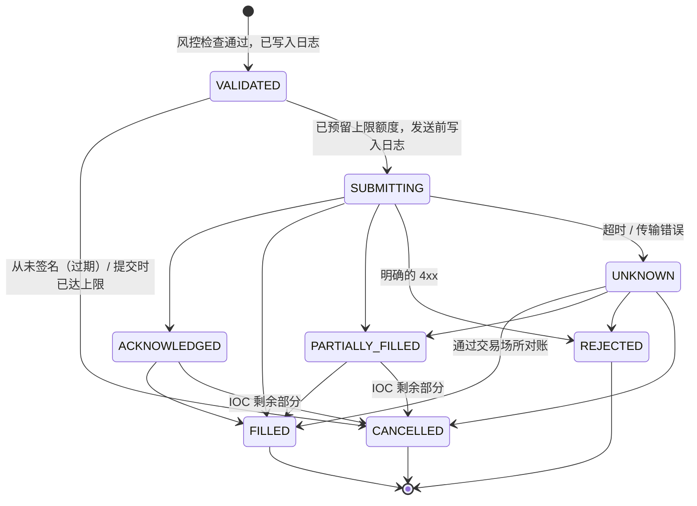

`UNKNOWN` 状态的订单会通过其预先计算的交易场所订单 id 进行查询（先快速尝试三次，然后每 10 秒一次，重启后也会继续）。它**绝不会被重新提交**。`execution.rs`（`submit_row`、`OrderTracker`）

## 11. 交易场所 actor 的缓存与熔断器

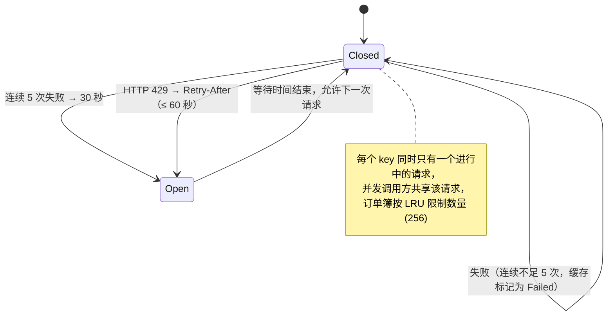

`crates/app/src/venue.rs`

## 12. 部署

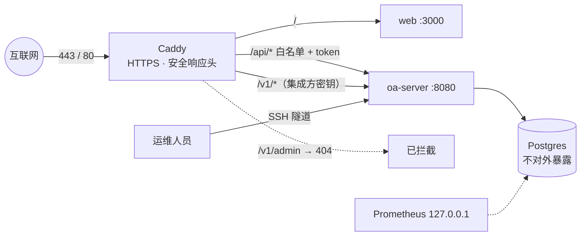

`deploy/docker-compose.yml`、`deploy/Caddyfile*` — 详见 [deployment.md](deployment.md)
