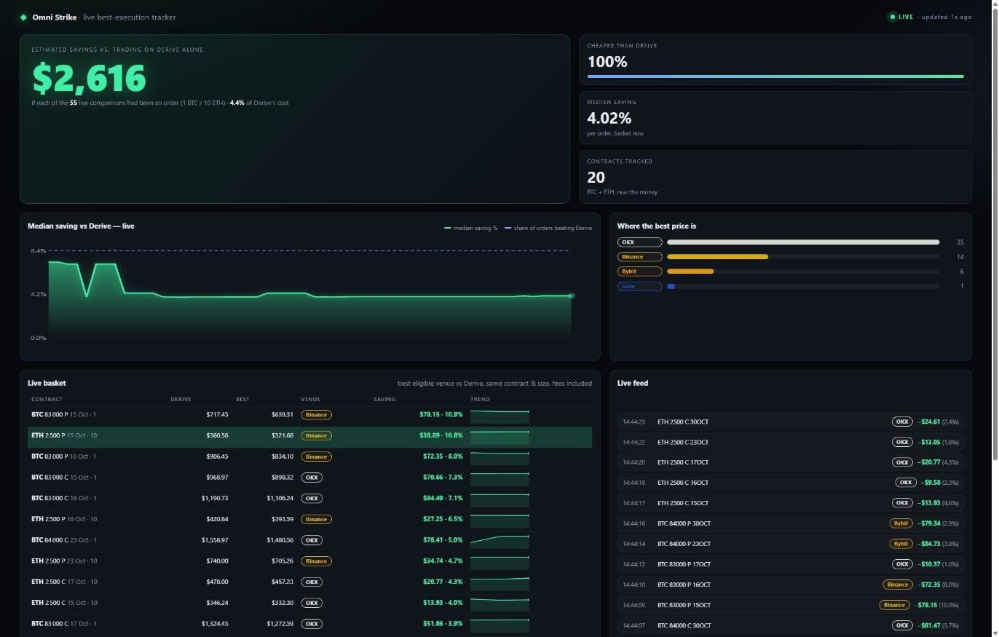

# Omni Strike web UI



Next.js 16 front end for the Omni Strike API: compare a contract across venues, build a route,
execute it with your own wallet (non-custodial), follow your orders.

```sh
pnpm install --frozen-lockfile
OA_BACKEND_URL=http://127.0.0.1:8080 pnpm dev      # http://localhost:3000
```

The browser only talks to this Next server; `/api/*` is proxied to `OA_BACKEND_URL`
(`next.config.ts`), so the backend needs no CORS. Wallet code: `lib/wallet.ts` (EIP-1193 /
EIP-6963, no dependency), `lib/noncustodial.ts` (prepare → sign → submit).
